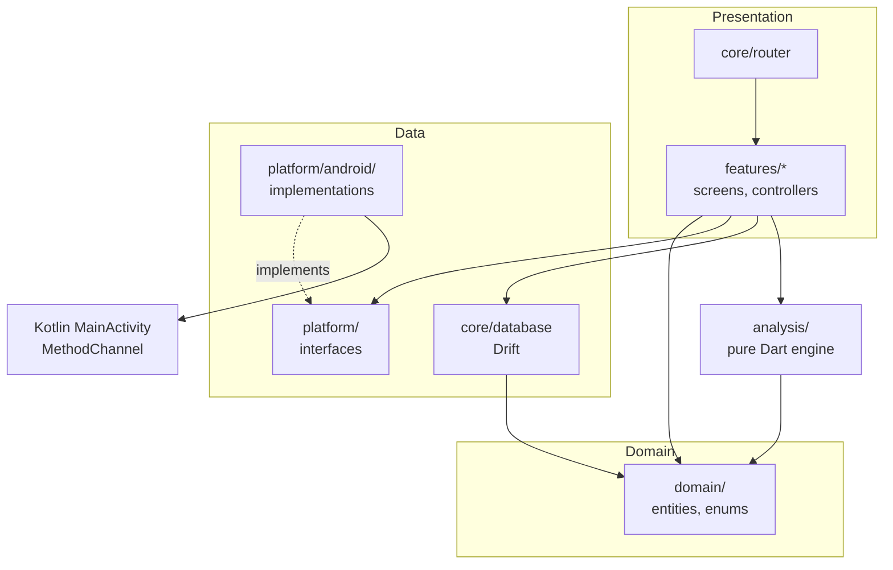
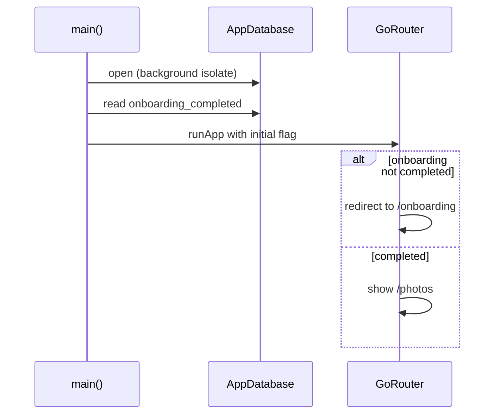
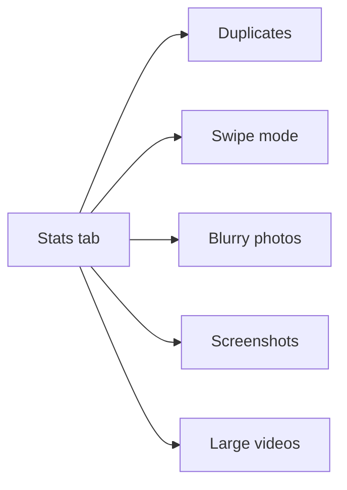

# Architecture

Clean Gallery uses a layered architecture organized by feature. Platform-specific code sits behind interfaces, so the UI and the analysis engine never depend on Android directly. This file describes the layers, where code lives, how data flows and which dependencies are allowed.

Last updated: 2026-10-26 — Milestone M3

## Layers



| Layer | Folder | Role |
| --- | --- | --- |
| Presentation | `lib/features/`, `lib/core/router/`, `lib/core/theme/` | Widgets ([design system](design.md)), Riverpod controllers, routes. |
| Domain | `lib/domain/` | Entities and enums shared by every layer. |
| Data | `lib/core/database/`, `lib/platform/` | Drift database, platform interfaces and their Android implementations. |
| Analysis engine | `lib/analysis/` | Detection algorithms, pure Dart, run in an isolate (from M3). |

The brief lists `core/`, `analysis/`, `platform/` and `features/` under `lib/`. `lib/domain/` is added so that the engine and the database share types without the engine depending on `core/` (see [ADR 0002](decisions/0002-layered-architecture.md)).

## Module map

| Path | Contents |
| --- | --- |
| [lib/main.dart](../lib/main.dart) | Opens the database, reads the onboarding flag, starts the app. |
| [lib/app.dart](../lib/app.dart) | Root widget: theme, localization, router. |
| [lib/core/providers.dart](../lib/core/providers.dart) | App-wide providers: database, settings, platform services. |
| [lib/core/config/app_config.dart](../lib/core/config/app_config.dart) | Build-time configuration (ad unit IDs). |
| [lib/core/database/](../lib/core/database/) | Tables, database class, repositories (settings, trash, media index). See [database.md](database.md). |
| [lib/core/router/](../lib/core/router/) | Routes (`AppRoutes`, `AlbumRoutes`, `ViewerArgs`), redirect rules, five-tab shell, `CompactNavBar`, `TabPage`. |
| [lib/core/media/](../lib/core/media/) | Media layer shared by library, viewer and trash: `MediaIndex` (keeps the `assets` table in sync with the device, [ADR 0015](decisions/0015-persistent-media-index.md)), `mediaListProvider` and related providers reading it, `MediaThumbnail`, formatting, `MediaActions` (trash, restore, favorite, delete for good, share), `SelectionBar` and `SelectionMode`. |
| [lib/core/settings/](../lib/core/settings/) | `AppSettings` and `AppSettingsController`. See [features/settings.md](features/settings.md). |
| [lib/core/theme/app_theme.dart](../lib/core/theme/app_theme.dart) | Theme and brand palette. See [design.md](design.md). |
| [lib/domain/](../lib/domain/) | `MediaItem`, `Album`, `MediaSelection`, timeline grouping, enums (`MediaKind`, `DateSource`, `DuplicateKind`, `SwipeAction`). |
| [lib/analysis/](../lib/analysis/) | Analysis engine; currently only `analysisVersion`. |
| [lib/platform/](../lib/platform/) | `MediaSource`, `PlatformBridge`, `PermissionService` interfaces. |
| [lib/platform/android/](../lib/platform/android/) | Android implementations. See [platform-android.md](platform-android.md). |
| [lib/features/onboarding/](../lib/features/onboarding/) | Onboarding. See [features/onboarding.md](features/onboarding.md). |
| [lib/features/library/](../lib/features/library/) | Photos and Videos timelines, Albums tab, album pages. See [features/library.md](features/library.md). |
| [lib/features/viewer/](../lib/features/viewer/) | Full-screen viewer and video player. See [features/viewer.md](features/viewer.md). |
| [lib/features/trash/](../lib/features/trash/) | Trash page and daily purge offer. See [features/trash.md](features/trash.md). |
| [lib/features/settings/](../lib/features/settings/) | Settings tab. See [features/settings.md](features/settings.md). |
| [lib/features/stats/](../lib/features/stats/) | Stats tab (layout only until M5). |
| [assets/fonts/manrope/](../assets/fonts/manrope/) | Bundled Manrope variable font and its license. |
| [lib/l10n/](../lib/l10n/) | ARB files for English and French. |

## Dependency rules

1. `analysis/` and `domain/` import neither Flutter nor any other app layer. They stay testable with plain Dart and can run in an isolate.
2. `features/` depend on interfaces in `platform/`, never on `platform/android/`. Concrete implementations are wired only in [lib/core/providers.dart](../lib/core/providers.dart).
3. Only `platform/android/` talks to the Kotlin MethodChannel.
4. Features do not import each other's internals. Shared code moves to `core/` or `domain/`.

Rules 1 and 2 are checked by [test/architecture/dependency_rules_test.dart](../test/architecture/dependency_rules_test.dart).

## Dependency injection

Every service is a Riverpod provider returning an interface. Tests and a future iOS build override the provider:

```dart
ProviderScope(
  overrides: [
    permissionServiceProvider.overrideWithValue(FakePermissionService()),
  ],
  child: const CleanGalleryApp(),
)
```

## Startup flow



The flag is read before the first frame, so the router chooses the first screen synchronously, without a loading state. When onboarding completes, the router's `refreshListenable` re-runs the redirect.

Once the tabs are shown, lists read the media index in the database, so the last known library appears at once; the shell then starts a sync with MediaStore (also at each return to the foreground), and open lists refresh in place when it changes something ([library.md](features/library.md#media-index)).

## Tabs

| Tab | Route | Content | Milestone |
| --- | --- | --- | --- |
| Camera | `/camera` | Timeline of the camera's photos (`DCIM/Camera/`) | M1 ✓, camera-only since M2 |
| Videos | `/videos` | Video timeline | M1 ✓ |
| Albums | `/albums`, `/albums/<key>?name=`, `/albums/trash` | All media, Favorites, Trash, folders | M1–M2 ✓ |
| Stats | `/stats` | Reclaimable space, entry to cleanup tools | Layout in M0, values in M5 |
| Settings | `/settings` | Settings | M2 ✓ |

The viewer (`/viewer`) sits above the tabs, without the navigation bar.

Defined in [app_router.dart](../lib/core/router/app_router.dart) (`AppRoutes`); the order must match the destinations in [home_shell.dart](../lib/core/router/home_shell.dart). Why five tabs: [ADR 0008](decisions/0008-navigation-and-visual-identity.md).



The cleanup tools have no tab of their own: the Stats tab is their entry point.

## Adding an iOS implementation later

1. Implement each interface in `lib/platform/` under a new `lib/platform/ios/` folder.
2. Pick the implementation per platform in [lib/core/providers.dart](../lib/core/providers.dart).
3. No change is needed in `features/`, `analysis/` or `domain/`.
