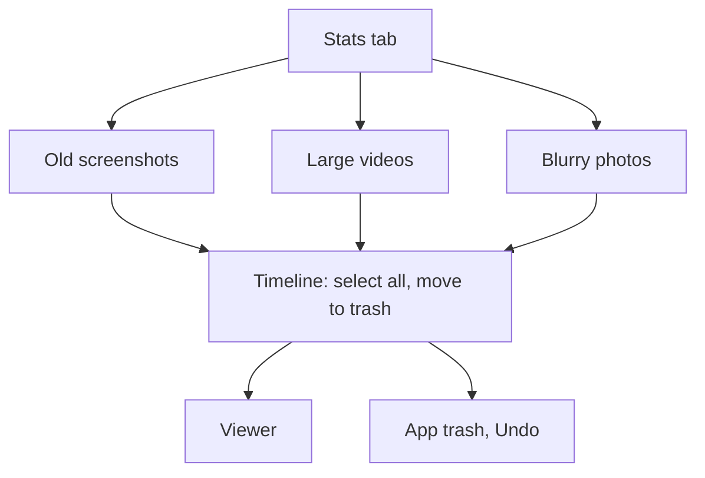

# Cleanup lists

Lists of items worth cleaning, opened from the Stats tab: **old screenshots**, **large videos** and **blurry photos**. Each is a timeline with selection and batch move to the trash.

Last updated: 2026-10-27 — Milestone M5

## Purpose

The brief's "Clean" tab lists categories whose items can usually go: screenshots older than N days, videos over a size, blurry or failed photos. "Each list supports selection and batch move to trash." The app's Stats tab is that tab ([stats.md](stats.md)).

## User flows

1. **Stats tab** → second card → **Old screenshots**, **Large videos** or **Blurry photos** (count and size on the right).
2. The list opens under the Stats tab, titled, with its rule and its total under the title:
   - *Old screenshots* — *Taken more than 30 days ago* — *42 items · 120 MB*, newest first, with date headers.
   - *Large videos* — *100 MB or more, largest first* — *5 items · 2.1 GB*, largest first.
   - *Blurry photos* — *Out of focus or too dark, as the analysis measured them*, newest first; fills in as the analysis goes.
3. Tap an item to open the viewer; long-press to select, drag to extend the selection.
4. **Select all** (selection bar), then **Move to trash**: the items go to the app trash with an *Undo* snackbar, and the list and the Stats values shrink.
5. The thresholds are set in **Settings → Cleanup**: screenshots count as old after **7 d / 30 d / 90 d / 1 yr** (30 days by default), videos count as large from **50 / 100 / 250 / 500 MB** (100 MB by default).

## Rules

| List | Items | Order |
| --- | --- | --- |
| Old screenshots | Photos recognized as screenshots ([analysis-engine.md](../analysis-engine.md#screenshots)) taken before the day *N* days ago (whole days, by the date the timelines use) | Newest first |
| Large videos | Videos of at least *M* MB (1 MB = 1,048,576 bytes, as sizes are shown) | Largest first |
| Blurry photos | Photos, screenshots left out, with a sharpness below 30 that is also low for their contrast (hazy photos in focus left out, M6), or a brightness below 20 ([analysis-engine.md](../analysis-engine.md#blurry-and-dark-photos)) | Newest first |

Trashed items are left out. The user can change the sort and limit the dates like on any timeline; the rule itself always applies.

## Screens and widgets

| Widget | File |
| --- | --- |
| `CleanupListScreen` | [cleanup_list_screen.dart](../../lib/features/cleanup/cleanup_list_screen.dart) |
| `MediaTimelineView` (with `subtitle`, `summary`, **Select all**) | [media_timeline_view.dart](../../lib/features/library/media_timeline_view.dart) |
| Cleanup settings | [settings_screen.dart](../../lib/features/settings/settings_screen.dart) |

Routes: `/stats/screenshots`, `/stats/large-videos` and `/stats/blurry` (`CleanupRoutes`), inside the Stats branch so the navigation bar stays.

## State and data

| Item | File | Role |
| --- | --- | --- |
| `CleanupList`, `oldScreenshots`, `largeVideos`, `poorQualityPhotos`, `cleanupSelectionProvider` | [cleanup_lists.dart](../../lib/features/cleanup/cleanup_lists.dart) | The selection of each list from the settings. |
| `MediaFilter.screenshots`, `largeVideos`, `poorQuality`, `MediaSelection.takenBefore`, `minSizeBytes` | [album.dart](../../lib/domain/album.dart) | Read by the media index like any other selection. |
| `assets.is_screenshot` | [media_index_repository.dart](../../lib/core/database/media_index_repository.dart) | Set while indexing ([database.md](../database.md)). |
| `screenshotAgeDays`, `largeVideoMegabytes` | [app_settings.dart](../../lib/core/settings/app_settings.dart) | Stored in `settings` (`screenshot_age_days`, `large_video_megabytes`). |

## Edge cases and error handling

- **Nothing to clean**: *No old screenshots* / *No large videos* / *No blurry photos*.
- **Before the analysis reaches a photo**, it is not in the Blurry photos list; the list grows while the analysis runs.
- **Screen recordings** in the Screenshots folder are videos: not in the screenshot list (they are in Large videos when big enough).
- **A screenshot that is also a duplicate** shows in both places; Stats counts it once, under duplicates.
- **A threshold changed** in Settings: the list and the Stats values follow at once.
- **Select all** selects every item of the list as shown (with the user's date filter, if any).

## Tests

- [screenshot_test.dart](../../test/analysis/screenshot_test.dart): folder, name, PNG at the screen size, what is not a screenshot.
- [cleanup_selection_test.dart](../../test/core/database/cleanup_selection_test.dart): the three lists read from the index.
- [cleanup_flow_test.dart](../../test/features/cleanup/cleanup_flow_test.dart): Stats rows, select all and move to trash, the large video threshold, blurry photos measured and listed.
- [image_quality_test.dart](../../test/analysis/image_quality_test.dart): the sharpness and brightness measures.
- [app_settings_test.dart](../../test/core/settings/app_settings_test.dart): thresholds stored and read back.

## Known limitations / future work

- The blur and darkness thresholds are fixed, from synthetic photos; a setting may follow once checked on real photos.
- To sort a list one photo at a time, the [sort mode](swipe.md) offers blurry photos and old screenshots as sources.
- Only the four offered thresholds can be picked; other values are kept if stored, with no segment selected.
