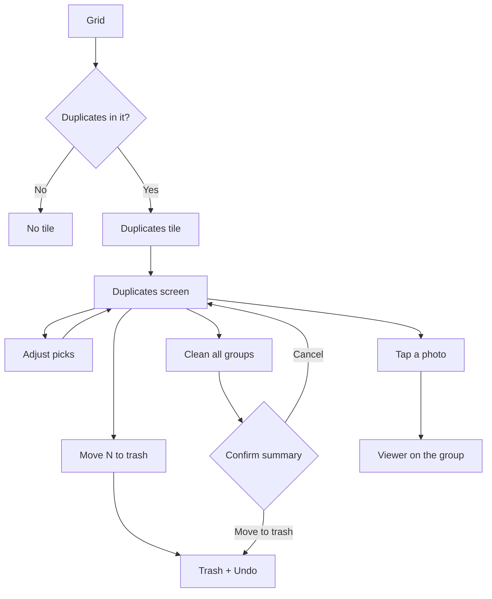

# Duplicates

The "Duplicates" virtual folder at the top of grids and the duplicates screen, where the user reviews groups of identical items and moves the extra copies to the trash.

Last updated: 2026-10-26 — Milestone M3

## Purpose

Find copies of the same photo or video (saved twice, received twice, copied to another folder) and free their space in a few taps, without risking the copy the user wants: the best one is suggested, the others are pre-selected, and everything goes through the trash.

## User flows

1. A grid (Camera, Videos, an album, All media, Favorites) shows a **Duplicates** tile above the photos when its items hold extra copies: "3 extra copies · 12 MB". There is no tile otherwise.
2. Tapping it opens the duplicates screen for that grid: only duplicates among its items, so All media also finds copies across folders.
3. Each group shows its items side by side with resolution, size and date. The item to keep has a **Best** badge; the others are **pre-selected** (dimmed, check mark).
4. Tap the round button on a photo to pick or keep it; tap the photo itself to open it full screen and swipe through the group.
5. **Move N to trash** under a group trashes its picked items, with *Undo*.
6. **Clean all groups** at the bottom shows a summary ("Move 128 items (1.4 GB) to the trash?"), then trashes every picked item, with *Undo*.
7. A group disappears once fewer than two of its items remain outside the trash; restoring one brings it back.

## Screens and widgets

| Widget | File |
| --- | --- |
| `DuplicatesTile` (in every grid, through `MediaTimelineView`) | [duplicates_tile.dart](../../lib/core/media/duplicates_tile.dart) |
| `DuplicatesScreen`, group cards | [duplicates_screen.dart](../../lib/features/duplicates/duplicates_screen.dart) |

The screen is a full-screen route above the tabs (`AppRoutes.duplicates`, with the grid's `MediaSelection` as `extra`).

## State and data

| Item | File | Role |
| --- | --- | --- |
| `DuplicateScan` | [duplicates.dart](../../lib/core/media/duplicates.dart) | Hashes new candidates and rebuilds the groups after each index sync. |
| `duplicateGroupsProvider(scope)` | same | Groups among the items of a grid's filter and folder, trashed items left out. |
| `DuplicateSelection(scope)` | [duplicate_selection.dart](../../lib/features/duplicates/duplicate_selection.dart) | The user's changes to the default picks. |
| `DuplicateRepository` | [duplicate_repository.dart](../../lib/core/database/duplicate_repository.dart) | Hash candidates, saved hashes, group rebuild. |
| `MediaIndexRepository.duplicateGroups` | [media_index_repository.dart](../../lib/core/database/media_index_repository.dart) | Groups filtered by a selection. |
| `DuplicateGroup` | [duplicate_group.dart](../../lib/domain/duplicate_group.dart) | A group, best item first. |
| Tables | [database.md](../database.md#duplicate_groups) | `assets.content_hash`, `duplicate_groups`, `duplicate_members`. |

Detection rules and the "Best" choice are in [analysis-engine.md](../analysis-engine.md#exact-duplicates).

## Edge cases and error handling

- **The best item is outside the grid** (e.g. the copy kept in Camera, the grid is WhatsApp): the best is chosen again among the items shown.
- **Every copy kept**: the group's button is disabled; with nothing picked anywhere, *Clean all groups* is hidden.
- **Every copy picked**: allowed; the user chose it, and the trash keeps them for the retention period.
- **Scan still running**: a thin progress bar under the title; "Looking for duplicates…" while nothing is found yet.
- **Unreadable file**: not hashed, so never grouped; it is tried again when its file changes.

## Tests

- [duplicates_flow_test.dart](../../test/features/duplicates/duplicates_flow_test.dart): tile and its count, no tile without duplicates, clean all keeps the best, keeping every copy, opening a photo full screen.
- [duplicates_test.dart](../../test/core/media/duplicates_test.dart) and [best_picker_test.dart](../../test/analysis/best_picker_test.dart): detection, see [analysis-engine.md](../analysis-engine.md#tests).

## Known limitations / future work

- Only exact duplicates for now. Bursts join the "Certain duplicates" section next (M3), similar photos get their own section in M4.
- "Not duplicates" (ignored pairs) comes with similar photos in M4; exact copies are identical by definition.
- The Stats tab's Duplicates card (whole library) comes with the Stats values (M5).
