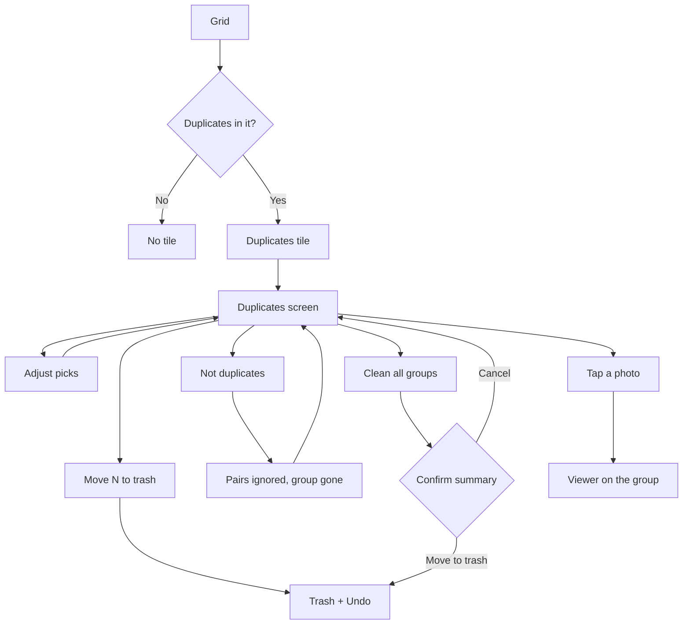

# Duplicates

The "Duplicates" virtual folder at the top of grids and the duplicates screen, where the user reviews groups of identical items, burst shots and similar photos, and moves the extra ones to the trash.

Last updated: 2026-11-04 — Visual refresh

## Purpose

Find copies of the same photo or video (saved twice, received twice, copied to another folder), the shots of a burst, and photos that look alike (a resized copy, several shots of the same scene) and free their space in a few taps, without risking the photo the user wants: the best one is suggested, the others are pre-selected, and everything goes through the trash.

## User flows

1. A grid (Camera, Videos, an album, All media, Favorites) shows a **Duplicates** tile above the photos when its items hold duplicates: "3 items to review · 12 MB", the items suggested for the trash and their size (an item in two groups counts once). There is no tile otherwise. The Stats tab opens the same screen for the whole library ([stats.md](stats.md)).
2. Tapping it opens the duplicates screen for that grid: only duplicates among its items, so All media also finds copies across folders.
3. Choice chips at the top pick what to show: **All · N**, **Identical copies · N**, **Bursts · N**, **Similar photos · N** (N groups; a kind without groups has no chip; no chips at all when there is a single kind). Under **All**, the groups come in one titled section per kind, in that order; under a kind, only its groups, and *Clean all groups* applies to them only. The product owner asked for these chips on 2026-10-27, since one *Certain duplicates* section mixed identical copies and bursts. Each group shows its items side by side with resolution, size, date and full path (folder and file name, never truncated, since the end of the path is what tells copies apart; asked by the product owner after the first device test). The item to keep has a **Best** badge; the others are **pre-selected** (dimmed, check mark).
4. **Sort** (button in the top bar): *Newest first* (the default) or *Most duplicates first*, the groups with the most items on top, groups of one size newest first. Applies inside each section; not saved (product owner, 2026-10-28).
5. Tap the round button on a photo to pick or keep it; tap the photo itself to open it full screen and swipe through the group.
6. **Move N to trash** under a group trashes its picked items, with *Undo*.
7. **Not duplicates** under a similar group: the group disappears with "These photos won't be grouped again." Its photos are never grouped together again, even after *Analyze the library again* ([analysis-engine.md](../analysis-engine.md#not-duplicates)). Certain duplicates have no such button: they are identical by definition.
8. **Clean all groups** at the bottom shows a summary ("Move 128 items (1.4 GB) to the trash?"), then trashes every picked item, with *Undo*.
9. A group disappears once fewer than two of its items remain outside the trash; restoring one brings it back.

## Look

The *Best* pill carries a small petal, the mark of the app; thumbnails have an 18 dp radius in this review screen. [Mockup](../design-assets/mockups/screens/07-duplicates.png).

## Screens and widgets

| Widget | File |
| --- | --- |
| `DuplicatesTile` (in every grid, through `MediaTimelineView`) | [duplicates_tile.dart](../../lib/core/media/duplicates_tile.dart) |
| `DuplicatesScreen`, group cards | [duplicates_screen.dart](../../lib/features/duplicates/duplicates_screen.dart) |

The screen is a full-screen route above the tabs (`AppRoutes.duplicates`, with the grid's `MediaSelection` as `extra`, and an optional `kind` query parameter for the chip selected at first).

## State and data

| Item | File | Role |
| --- | --- | --- |
| `DuplicateScan` | [duplicates.dart](../../lib/core/media/duplicates.dart) | After each index sync: content hashes, certain groups, perceptual hashes, similar groups; `ignore` for "Not duplicates"; runs again when the sensitivity changes. |
| `duplicateGroupsProvider(scope)` | same | Groups among the items of a grid's filter and folder, trashed items left out. |
| `DuplicateSelection(scope)` | [duplicate_selection.dart](../../lib/features/duplicates/duplicate_selection.dart) | The user's changes to the default picks. |
| `DuplicateRepository` | [duplicate_repository.dart](../../lib/core/database/duplicate_repository.dart) | Hash candidates, saved hashes, group rebuilds, ignored pairs. |
| `MediaIndexRepository.duplicateGroups` | [media_index_repository.dart](../../lib/core/database/media_index_repository.dart) | Groups filtered by a selection. |
| `DuplicateGroup` | [duplicate_group.dart](../../lib/domain/duplicate_group.dart) | A group, best item first. |
| Tables | [database.md](../database.md#duplicate_groups) | `assets.content_hash`, `d_hash`, `p_hash`, `duplicate_groups`, `duplicate_members`, `ignored_pairs`. |

Detection rules and the "Best" choice are in [analysis-engine.md](../analysis-engine.md#exact-duplicates) and [analysis-engine.md](../analysis-engine.md#similar-photos).

## Edge cases and error handling

- **The best item is outside the grid** (e.g. the copy kept in Camera, the grid is WhatsApp): the best is chosen again among the items shown.
- **Every copy kept**: the group's button is disabled; with nothing picked anywhere, *Clean all groups* is hidden.
- **Every copy picked**: allowed; the user chose it, and the trash keeps them for the retention period.
- **Scan still running**: a thin progress bar under the title, filled as items are read; "Looking for duplicates…" and "Analyzing: N of M items" while nothing is found yet. Similar groups appear every 1,000 photos read, not only at the end.
- **Opened from a Stats category**: the chip of that kind is selected (`/duplicates?kind=exact|burst|similar`); *All* goes back to every group.
- **The last group of the chosen kind is cleaned**: its chip stays, at 0, with the empty state, until another chip is chosen.
- **Unreadable file**: not hashed, so never grouped; it is tried again when its file changes. The same for a photo without a thumbnail.
- **An item in a certain and a similar group** (a copy that also looks like a third photo): shown in both; *Clean all groups* and the counts take it once.
- **Not duplicates during the first analysis**: the group goes at once; the regrouping waits for the scan in progress.
- **Large text**: the group's buttons stack when they do not fit side by side.

## Tests

- [duplicates_flow_test.dart](../../test/features/duplicates/duplicates_flow_test.dart): tile and its count, no tile without duplicates, clean all keeps the best, keeping every copy, opening a photo full screen.
- [duplicate_sort_flow_test.dart](../../test/features/duplicates/duplicate_sort_flow_test.dart): the screen sorted by most duplicates (opened from All media, which also guards the hero fix below), a timeline sorted by duplicates, Albums folders sorted by duplicates.
- [duplicate_sort_test.dart](../../test/core/media/duplicate_sort_test.dart): the duplicates order of the index (largest groups first, a group together, ascending, chunks, a trashed copy), duplicates per folder.
- [similar_flow_test.dart](../../test/features/duplicates/similar_flow_test.dart): similar photos section, Not duplicates, the Stats tab opening the screen.
- [duplicates_test.dart](../../test/core/media/duplicates_test.dart) and [best_picker_test.dart](../../test/analysis/best_picker_test.dart): detection, see [analysis-engine.md](../analysis-engine.md#tests).

## Known limitations / future work

- Similar groups pre-select every photo but the best, as the brief asks; similar photos are not copies, so the product owner may prefer them unselected (to decide after the device test).
- The confidence score is stored but not shown.
- Sharpness picks the best photo of bursts and similar groups of the same resolution; a member below the blur threshold is labelled **Blurry** under its resolution.
- Similar videos (same duration, resolution and close dates) are not detected yet.
