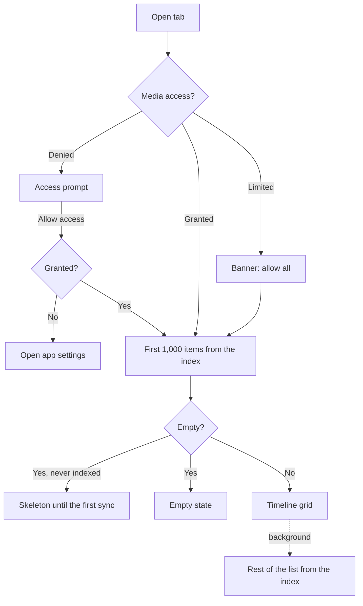

# Library

Browsing the device's photos and videos: the Camera and Videos timelines, the Albums tab and album pages.

Last updated: 2026-11-11 — Issue #19

## Purpose

Show every photo and video on the device, newest first, grouped by day or month, in a grid the user can zoom by pinching. Albums gives access to all media, favorites and each device folder. Lists read the app's media index, a copy of the library's metadata in the database, so they show at once at launch; the index catches up with the device in the background. Only metadata is copied, never the media.

## User flows

1. **Camera / Videos tab**: the timeline opens on the newest items. Camera shows only the photos taken with the device camera (`DCIM/Camera/`); Videos shows every video; everything else is in **Albums → All media**. Section headers read "Today", "Yesterday", then full dates.
2. **Pinch** with two fingers: spreading shows fewer, larger thumbnails (down to 2 columns); pinching shows more (up to 6). From 5 columns, headers switch from days to months.
3. **Pull down** to pick up changes at once (new photos, deletions made in another app). The app also does it at launch and when it returns to the foreground.
4. **Tap a thumbnail**: the viewer opens on that item ([viewer.md](viewer.md)).
5. **Albums tab**: "All media", "Favorites", "Map" ([map.md](map.md)) and "Trash", then **My albums**, the user's own albums ([user-albums.md](user-albums.md)), then "Folders" sorted by size. Tapping one opens its timeline, with a back button.
6. **Sort and filter**: the button next to the title opens a sheet (see below). The Camera, Videos, Albums and album page titles also have a magnifier that searches that timeline ([search.md](search.md)).
7. **Duplicates**: when a grid holds extra copies, a tile above the photos opens them ([duplicates.md](duplicates.md)).
8. **Stacks**: duplicates taken one after the other show as one thumbnail (see below).

## Stacks

In date order, consecutive items of one duplicate group (identical copies, a burst or similar photos) taken the same day fold into one thumbnail, a **stack**: the group's best pick on top, an accent badge with the number of items in the top right corner.

- **Tap** a stack: it unfolds in place, its items in their usual order, an accent line under each. A photo of an unfolded stack opens the viewer; the round button on the best pick's thumbnail folds the stack again.
- **Select**: a long press or a tap in selection mode selects every item of a folded stack; a drag over it too. Unfolded, each item is selected on its own.
- Only items next to each other stack: a group member taken between two unrelated photos stays alone, and a stack never crosses midnight, so it stays in its date section.
- An item in a certain group (copies, burst) and a similar group stacks with its certain group.
- Stacks are keyed by their best pick, so a stack stays unfolded while the analysis regroups; they all fold again when the page is left.
- The viewer still shows every item, stacked or not, one after the other.
- No stacks when the grid is sorted by name, size or duration, nor in the cleanup lists, where every item is a candidate for the trash.

Code: `buildCells` in [timeline.dart](../../lib/domain/timeline.dart) (pure Dart), used by `_Timeline` in [media_timeline_view.dart](../../lib/features/library/media_timeline_view.dart); the groups come from `duplicateGroupsProvider`, like the Duplicates tile.

## Selection and actions

- **Long press** a thumbnail to start selecting; **drag** without lifting to select every item between the first one and the finger (if the first item was already selected, the drag deselects). Near the top or bottom edge the grid scrolls by itself.
- **Tap** adds or removes an item; **back** or the close button leaves selection mode.
- **Screen readers** (TalkBack): the grid's sliding long press needs the finger's position, so it is hidden from them; each thumbnail offers its own long press instead (*select*), which selects that item and starts selection mode (M12).
- The selection bar offers **share** ([sharing.md](sharing.md)), **favorite** ([favorites.md](favorites.md)) and **move to trash** with *Undo* ([trash.md](trash.md)); its **More** menu (⋮) holds **add to album** ([user-albums.md](user-albums.md)), **select all** and the page's own actions (a user album's *Remove from album*, *Use as cover*). The bar has room for four buttons next to the count on a phone, so beyond four actions the first three stay buttons.
- Trashed items disappear from every list at once.

## Fast scrolling

On long lists (three screens or more), a thumb appears on the right edge while scrolling and fades out 1.5 s after it stops. Dragging it jumps anywhere in the list; a bubble next to it shows where the user is going:

| Sort | Bubble |
| --- | --- |
| Date | Month and year, e.g. "March 2024" |
| Size | File size, e.g. "4.2 MB" ("4,2 Mo" in French) |
| Duration | Video length, e.g. "1:15" |
| Name | First letter |

Widget: [fast_scroller.dart](../../lib/features/library/fast_scroller.dart).

## Performance

- **Actions never reload lists.** Screens read `visibleMediaListProvider`, which applies the trash and in-app favorite changes to the loaded list in memory; lists query the index again only when it changes (a sync, a permanent deletion). (Before this, every trash, undo or favorite reloaded every list, which felt like latency after each action.)
- **The grid layout is memoized**: sections, rows and offsets are recomputed only when the list, column count, order, text size or width change.
- **Selection is a `ValueNotifier`**: a tap rebuilds the visible cells and the selection bar, not the grid.
- **Date formats are cached** by pattern and locale; each thumbnail formats a date for its screen reader label.

- Every row has a known height (date headers a fixed height growing with the text size, item rows one cell), so the grid is a `SliverVariedExtentList`: jumping far with the thumb never lays out the rows in between.
- Thumbnails one screen above and below are prefetched (`scrollCacheExtent`).
- Flutter's image cache holds up to 2,000 images / 200 MB, so scrolling back does not reload thumbnails.
- The Albums tab gets every folder's name, count and cover from one SQLite query on the index (grouped by folder, newest item as cover).
- Thumbnails come from MediaStore's own thumbnail cache through a native loader, as raw pixels, newest request first, so the screen you land on after a far jump loads before the rows scrolled past ([platform-android.md](../platform-android.md#why-not-photo_manager-thumbnails)).

## Media index

Lists read the `assets` table, kept in sync with MediaStore by `MediaIndex` ([ADR 0015](../decisions/0015-persistent-media-index.md)):

1. **When**: at launch, when the app returns to the foreground, and on pull-to-refresh. A call during a sync adds one more pass.
2. **Snapshot**: the id and revision (`GENERATION_MODIFIED`) of every item, newest first, in one query.
3. **Compare** with the stored revisions: new and changed items are described (full metadata, 1,000 per call), their capture date is resolved ([analysis-engine.md](../analysis-engine.md#capture-date)), and they are written; missing items are removed with their trash entries.
4. **Refresh lists**: open lists query the index again and replace their content without a loading state. On a long sync, after the first 1,000 items, then at most once a second.

- A favorite changed in the app is written to the index at once; MediaStore confirms it at the next sync.
- If MediaStore rebuilt its database (its version changed), or the capture date rules changed, every item is described again.
- Turning **Corrected dates** off or on in Settings reloads the lists from the index, without a sync.
- **Limited access**: the index holds only the shared items, but items in the app trash are kept.
- **Denied access** or a platform error: the sync stops and the index stays as it was.

## Sorting and date filter

Every timeline (Photos, Videos, each album) can be sorted and limited to a date range ([ADR 0012](../decisions/0012-sort-and-date-filter.md)).

| Sort by | Directions | Default direction |
| --- | --- | --- |
| Date (capture date: corrected or Android's, per Settings) | Newest first / Oldest first | Newest first |
| Name | A to Z / Z to A | A to Z |
| Size | Largest first / Smallest first | Largest first |
| Duration (not on Photos) | Longest first / Shortest first | Longest first |
| Duplicates (M6) | Most duplicates first / Fewest first | Most duplicates first |

| Period | Range |
| --- | --- |
| All time | No filter |
| Last 7 days, Last 30 days | Today and the previous 6 or 29 days |
| This year | From January 1st |
| Last year | The previous calendar year |
| Custom… | Any range from the system date range picker |

- Changes apply immediately; *Reset* returns to newest first, all dates.
- Active choices show as chips under the title; tapping a chip reopens the sheet, its cross removes it.
- The filter button shows an accent dot when the view is customized.
- Date headers only appear in date order; other orders show a plain grid.
- **Duplicates** order: items by the number of items in their duplicate group (largest groups first), the items of one group next to each other, newest first within a group; items without duplicates at the end, newest first. Sorted in memory after loading the whole selection (`MediaIndexRepository._loadByDuplicates`): `duplicate_members` has no index by asset, so SQL would scan it once per item. The list reloads when the groups change. No fast-scroll bubble in this order. Asked by the product owner on 2026-10-28.
- **Albums → Folders** has its own sort button: by size (the default) or by duplicates, the folders holding the most items in a duplicate group first, each tile then reading "120 items · 8 duplicates". Kept until the app is closed.
- A period with no item shows "Nothing in this period" with *Clear filter*.
- Each tab and album keeps its own choice until the app is closed.

## Thumbnail size

Each thumbnail asks for the size it is shown at, so it stays sharp at any number of columns, on memory cards and on album covers (issue reported on 2026-11-11).

- `thumbnailPixels` ([media_thumbnail.dart](../../lib/core/media/media_thumbnail.dart)) turns a side in dp into the step of `thumbnailSteps` (192 to 1280 pixels) at or above it on this screen. The grid computes it from its column count, so the image cache key only changes with the columns; `MediaThumbnail` without a `pixelSize` measures its own box.
- Before, the grid asked for 256 pixels at four columns or more and 512 below, memory cards for 512 and album covers for 768, whatever their real size.
- MediaStore's thumbnails stop at 512 pixels on Samsung phones (512 × 384 for a 4:3 photo, 267 × 578 for a tall screenshot). **Two steps**: the cached thumbnail always shows first; when its short side is under 80 % of the size asked for, `SharpUpgrade` lays the photo decoded from its file (`MediaSource.sharpThumbnail`) over it, fading in. In practice: two columns, album covers, memory cards and tall photos.
- The sharp versions wait in a **lane of their own** in `ThumbnailLoader` (2 threads). The first version (2026-11-11) decoded them in the main lane instead of the cached thumbnail: each took about half a second, and the grid waited behind them. Measured on the phone (720 px wide screen, cells of 192 pixels at four columns): cached thumbnails decode in 17 ms but waited 390 ms (median) to 1 s; those decoded from files took 450–540 ms and waited 1.4 to 6.7 s at the 90th percentile.

## Thumbnails that fail

The native loader serves the newest requests first and drops the oldest beyond 200 waiting, which a fast scroll through a large library reaches: whole runs of thumbnails get a `dropped` error.

- `NativeThumbnailProvider` removes any failed load from Flutter's image cache, which otherwise keeps the error and replays it to whoever asks again. Before this fix (2026-11-05), a dropped thumbnail stayed blank until the app restarted, in runs of consecutive cells.
- `RetryingImage` ([retrying_image.dart](../../lib/core/media/retrying_image.dart)) asks again for what is still on screen: every 400 ms for a dropped request, without limit, since only mounted cells do it; up to three times (after 1, 2 and 3 s) for another failure, then a broken image icon.

## Look

Grids sit on a neutral background (`surfaceContainerLowest`) with Bricolage titles and section headers. The Albums tab starts with a mosaic: *All media* across the width, then Favorites (citron), Map, Slideshows and Trash; *My albums* and *Folders* follow. The *Slideshows* tile opens a page with *Slideshow*, *Memories* and the saved slideshows. Mockups: [grid](../design-assets/mockups/screens/02-grid-dark.png), [Albums](../design-assets/mockups/screens/03-albums.png).

## Screens and widgets

| Widget | File |
| --- | --- |
| `MediaTimelineView` (Camera, Videos, album pages) | [media_timeline_view.dart](../../lib/features/library/media_timeline_view.dart) |
| `AlbumsScreen` | [albums_screen.dart](../../lib/features/library/albums_screen.dart) |
| `PinchToChangeColumns` | [pinch_to_change_columns.dart](../../lib/features/library/pinch_to_change_columns.dart) |
| `FastScroller` | [fast_scroller.dart](../../lib/features/library/fast_scroller.dart) |
| `SortFilterSheet`, date presets and labels | [sort_filter_sheet.dart](../../lib/features/library/sort_filter_sheet.dart) |
| `MediaThumbnail` (shared with the viewer's Hero) | [media_thumbnail.dart](../../lib/core/media/media_thumbnail.dart) |

## State and data

| Item | File | Role |
| --- | --- | --- |
| `MediaSelection`, `Album`, `MediaItem` | [album.dart](../../lib/domain/album.dart), [media_item.dart](../../lib/domain/media_item.dart) | What to show, and the items. |
| `groupByDate`, `buildRows` | [timeline.dart](../../lib/domain/timeline.dart) | Pure-Dart grouping into sections and grid rows. |
| `mediaListProvider(selection)` | [media_providers.dart](../../lib/core/media/media_providers.dart) | All items of a selection from the index: the first 1,000, then the rest. Reloaded in place when the index changes. |
| `visibleMediaListProvider(selection)` | same | What grids and the viewer show: the list without trashed or deleted items, with in-app favorite changes; loading until the first sync if empty. |
| `deletedIdsProvider` | same | Items deleted for good this session, hidden until lists reload. |
| `favoriteOverridesProvider` | same | Favorite changes made in the app, applied without reloading lists. |
| `albumsProvider`, `mediaCountProvider`, `albumCoverProvider` | same | Albums tab data. Folders come with their count and cover; the count and cover providers serve the virtual albums (All media, Favorites). |
| `gridColumnsProvider` | same | Column count (2–6), shared by all grids; default 4. |
| `viewSelectionProvider(base)` | same | Sort and date range chosen for one tab or album. |
| `MediaSort`, `DateFilter` | [album.dart](../../lib/domain/album.dart) | Sort order and date range, part of `MediaSelection`. |
| `mediaAccessProvider` | same | Current permission level. |
| `mediaIndexProvider` (`MediaIndex`) | [media_index.dart](../../lib/core/media/media_index.dart) | Syncs the index; its state says whether the index is ready, syncing, and its revision. |
| `MediaIndexRepository` | [media_index_repository.dart](../../lib/core/database/media_index_repository.dart) | Index queries: lists, counts, covers, folders, sync writes. |
| `MediaSource` | [media_source.dart](../../lib/platform/media_source.dart) | Platform access ([platform-android.md](../platform-android.md#media-access)). |

Tables: `assets` (the index), `trash_entries`, `settings` (`media_index_version`) — see [database.md](../database.md#assets).

## Edge cases and error handling

- **Denied access**: prompt with *Allow access*; if the system no longer shows the dialog, the app settings open.
- **Limited access** (Android 14+): only the shared items are shown, with a banner to allow all.
- **Empty library or album**: empty state with a hint to pull down.
- **Load error**: message with *Retry*.
- **Large libraries**: the first 1,000 items show immediately, the rest follows from a second query. Only visible rows are built.
- **First launch**: lists show a skeleton until the first sync completes, then fill from the newest items as the library is indexed.
- **Same item twice on a page** (album covers): Hero is disabled on covers, since Hero tags must be unique per route.
- **Thumbnail failure**: a broken-image icon replaces the thumbnail.

## Tests

- [timeline_test.dart](../../test/domain/timeline_test.dart): day and month sections, row building, grouping by column count, stack cells (runs, cover, midnight, unfolded).
- [stack_test.dart](../../test/features/library/stack_test.dart): a stack folds two copies, unfolds on tap, opens the viewer unfolded, folds back, and selects all its items.
- [media_providers_test.dart](../../test/core/media/media_providers_test.dart): first chunk then the rest, reload in place, column limits, duration formatting.
- [media_index_test.dart](../../test/core/media/media_index_test.dart): sync plan, first and incremental syncs, analysis kept or reset, platform version change, denied and limited access, merged calls, index queries (filters, sorts, date range, folders, trash).
- [library_test.dart](../../test/features/library/library_test.dart): headers, photo/video filters, empty, denied and limited states, albums and folder pages, opening the viewer, pinch gesture.
- [sort_filter_test.dart](../../test/features/library/sort_filter_test.dart): date ranges and presets, plain rows, sorting by name, date preset and chip removal, empty period, viewer order, per-tab state.
- [selection_test.dart](../../test/features/library/selection_test.dart): long press, tap, drag range, trash with undo, favorite, share, back.
- [fast_scroller_test.dart](../../test/features/library/fast_scroller_test.dart): thumb shown on scroll and hidden after a pause, drag jumps with a month bubble, size bubble when sorted by size, no thumb on short lists, size formatting.

## Known limitations / future work

- Photos taken while the app stays open appear after pull-to-refresh or the next return to the app (no `ContentObserver` yet, [ADR 0015](../decisions/0015-persistent-media-index.md#alternatives-considered)).
- The date filter is not saved across launches (on purpose); the default column count and the sort of each view are ([settings.md](settings.md)).
- On the first device tests, new thumbnails appeared slowly after scrolling far. Prefetching, a larger image cache, fixed row heights and then the native thumbnail loader were added. The product owner then found the Camera and Videos timelines very fast on the Galaxy A54 (2026-10-25); no frame rate was measured.
