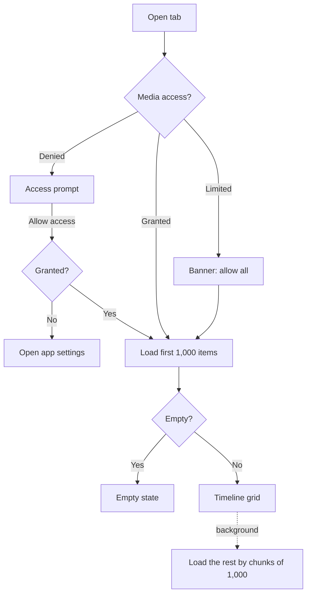

# Library

Browsing the device's photos and videos: the Photos and Videos timelines, the Albums tab and album pages.

Last updated: 2026-10-25 — Milestone M2

## Purpose

Show every photo and video on the device, newest first, grouped by day or month, in a grid the user can zoom by pinching. Albums gives access to all media, favorites and each device folder. Everything is read from MediaStore on demand; nothing is copied.

## User flows

1. **Photos / Videos tab**: the timeline opens on the newest items. Section headers read "Today", "Yesterday", then full dates.
2. **Pinch** with two fingers: spreading shows fewer, larger thumbnails (down to 2 columns); pinching shows more (up to 6). From 5 columns, headers switch from days to months.
3. **Pull down** to reload after taking new photos.
4. **Tap a thumbnail**: the viewer opens on that item ([viewer.md](viewer.md)).
5. **Albums tab**: "All media" and "Favorites", then "Folders" sorted by size. Tapping one opens its timeline, with a back button.
6. **Sort and filter**: the button next to the title opens a sheet (see below).

## Selection and actions

- **Long press** a thumbnail to start selecting; **drag** without lifting to select every item between the first one and the finger (if the first item was already selected, the drag deselects). Near the top or bottom edge the grid scrolls by itself.
- **Tap** adds or removes an item; **back** or the close button leaves selection mode.
- The selection bar offers **share** ([sharing.md](sharing.md)), **favorite** ([favorites.md](favorites.md)) and **move to trash** with *Undo* ([trash.md](trash.md)).
- Trashed items disappear from every list at once.

## Fast scrolling

On long lists (three screens or more), a thumb appears on the right edge while scrolling and fades out 1.5 s after it stops. Dragging it jumps anywhere in the list; a bubble next to it shows where the user is going:

| Sort | Bubble |
| --- | --- |
| Date | Month and year, e.g. "March 2024" |
| Size | File size, e.g. "4.2 MB" ("4,2 Mo" in French) |
| Duration | Video length, e.g. "1:15" |
| Name | First letter |

Widget: [fast_scroller.dart](../../lib/features/library/fast_scroller.dart).

## Performance

- Every row has a known height (date headers a fixed height growing with the text size, item rows one cell), so the grid is a `SliverVariedExtentList`: jumping far with the thumb never lays out the rows in between.
- Thumbnails one screen above and below are prefetched (`scrollCacheExtent`).
- Flutter's image cache holds up to 2,000 images / 200 MB, so scrolling back does not reload thumbnails.
- The Albums tab gets every folder's name, count and cover from one native query (`albumSummaries`) instead of one count and one cover lookup per folder; album pages reuse cached folder paths.
- Thumbnails come from MediaStore's own thumbnail cache through a native loader, as raw pixels, newest request first, so the screen you land on after a far jump loads before the rows scrolled past ([platform-android.md](../platform-android.md#why-not-photo_manager-thumbnails)).

## Sorting and date filter

Every timeline (Photos, Videos, each album) can be sorted and limited to a date range ([ADR 0012](../decisions/0012-sort-and-date-filter.md)).

| Sort by | Directions | Default direction |
| --- | --- | --- |
| Date (capture date) | Newest first / Oldest first | Newest first |
| Name | A to Z / Z to A | A to Z |
| Size | Largest first / Smallest first | Largest first |
| Duration (not on Photos) | Longest first / Shortest first | Longest first |

| Period | Range |
| --- | --- |
| All time | No filter |
| Last 7 days, Last 30 days | Today and the previous 6 or 29 days |
| This year | From January 1st |
| Last year | The previous calendar year |
| Custom… | Any range from the system date range picker |

- Changes apply immediately; *Reset* returns to newest first, all dates.
- Active choices show as chips under the title; tapping a chip reopens the sheet, its cross removes it.
- The filter button shows a lime dot when the view is customized.
- Date headers only appear in date order; other orders show a plain grid.
- A period with no item shows "Nothing in this period" with *Clear filter*.
- Each tab and album keeps its own choice until the app is closed.

## Screens and widgets

| Widget | File |
| --- | --- |
| `MediaTimelineView` (Photos, Videos, album pages) | [media_timeline_view.dart](../../lib/features/library/media_timeline_view.dart) |
| `AlbumsScreen` | [albums_screen.dart](../../lib/features/library/albums_screen.dart) |
| `PinchToChangeColumns` | [pinch_to_change_columns.dart](../../lib/features/library/pinch_to_change_columns.dart) |
| `FastScroller` | [fast_scroller.dart](../../lib/features/library/fast_scroller.dart) |
| `SortFilterSheet`, date presets and labels | [sort_filter_sheet.dart](../../lib/features/library/sort_filter_sheet.dart) |
| `MediaThumbnail` (shared with the viewer's Hero) | [media_thumbnail.dart](../../lib/core/media/media_thumbnail.dart) |

## State and data

| Item | File | Role |
| --- | --- | --- |
| `MediaSelection`, `Album`, `MediaItem` | [album.dart](../../lib/domain/album.dart), [media_item.dart](../../lib/domain/media_item.dart) | What to show, and the items. |
| `groupByDate`, `buildRows` | [timeline.dart](../../lib/domain/timeline.dart) | Pure-Dart grouping into sections and grid rows. |
| `mediaListProvider(selection)` | [media_providers.dart](../../lib/core/media/media_providers.dart) | All items of a selection, loaded by chunks of 1,000. Shared with the viewer. |
| `albumsProvider`, `mediaCountProvider`, `albumCoverProvider` | same | Albums tab data. Folders come with their count and cover; the count and cover providers serve the virtual albums (All media, Favorites). |
| `gridColumnsProvider` | same | Column count (2–6), shared by all grids; default 4. |
| `viewSelectionProvider(base)` | same | Sort and date range chosen for one tab or album. |
| `MediaSort`, `DateFilter` | [album.dart](../../lib/domain/album.dart) | Sort order and date range, part of `MediaSelection`. |
| `mediaAccessProvider` | same | Current permission level. |
| `MediaSource` | [media_source.dart](../../lib/platform/media_source.dart) | Platform access ([platform-android.md](../platform-android.md#media-access)). |

No database table is used yet: the index (`assets`) is filled from M3.

## Edge cases and error handling

- **Denied access**: prompt with *Allow access*; if the system no longer shows the dialog, the app settings open.
- **Limited access** (Android 14+): only the shared items are shown, with a banner to allow all.
- **Empty library or album**: empty state with a hint to pull down.
- **Load error**: message with *Retry*.
- **Large libraries**: the first chunk shows immediately; the timeline grows as the rest loads. Only visible rows are built.
- **Same item twice on a page** (album covers): Hero is disabled on covers, since Hero tags must be unique per route.
- **Thumbnail failure**: a broken-image icon replaces the thumbnail.

## Tests

- [timeline_test.dart](../../test/domain/timeline_test.dart): day and month sections, row building, grouping by column count.
- [media_providers_test.dart](../../test/core/media/media_providers_test.dart): chunked loading, column limits, duration formatting.
- [library_test.dart](../../test/features/library/library_test.dart): headers, photo/video filters, empty, denied and limited states, albums and folder pages, opening the viewer, pinch gesture.
- [sort_filter_test.dart](../../test/features/library/sort_filter_test.dart): date ranges and presets, plain rows, sorting by name, date preset and chip removal, empty period, viewer order, per-tab state.
- [selection_test.dart](../../test/features/library/selection_test.dart): long press, tap, drag range, trash with undo, favorite, share, back.
- [fast_scroller_test.dart](../../test/features/library/fast_scroller_test.dart): thumb shown on scroll and hidden after a pause, drag jumps with a month bubble, size bubble when sorted by size, no thumb on short lists, size formatting.

## Known limitations / future work

- New photos appear after pull-to-refresh, not automatically (MediaStore change listening comes with indexing in M3).
- The date filter is not saved across launches (on purpose); the default column count and the sort of each view are ([settings.md](settings.md)).
- The "Duplicates" tile at the top of grids comes in M3; the "Trash" album in M2.
- On the first device tests, new thumbnails appeared slowly after scrolling far. Prefetching, a larger image cache, fixed row heights and then the native thumbnail loader were added. To be measured again on a device (M9 target: 60 fps).
