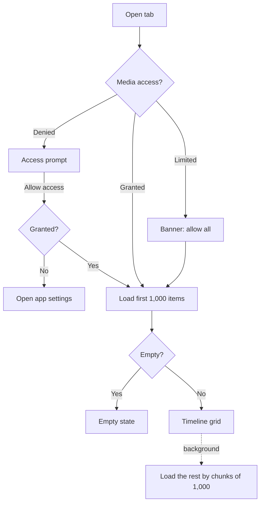

# Library

Browsing the device's photos and videos: the Photos and Videos timelines, the Albums tab and album pages.

Last updated: 2026-10-25 — Milestone M1

## Purpose

Show every photo and video on the device, newest first, grouped by day or month, in a grid the user can zoom by pinching. Albums gives access to all media, favorites and each device folder. Everything is read from MediaStore on demand; nothing is copied.

## User flows

1. **Photos / Videos tab**: the timeline opens on the newest items. Section headers read "Today", "Yesterday", then full dates.
2. **Pinch** with two fingers: spreading shows fewer, larger thumbnails (down to 2 columns); pinching shows more (up to 6). From 5 columns, headers switch from days to months.
3. **Pull down** to reload after taking new photos.
4. **Tap a thumbnail**: the viewer opens on that item ([viewer.md](viewer.md)).
5. **Albums tab**: "All media" and "Favorites", then "Folders" sorted by size. Tapping one opens its timeline, with a back button.

## Screens and widgets

| Widget | File |
| --- | --- |
| `MediaTimelineView` (Photos, Videos, album pages) | [media_timeline_view.dart](../../lib/features/library/media_timeline_view.dart) |
| `AlbumsScreen` | [albums_screen.dart](../../lib/features/library/albums_screen.dart) |
| `PinchToChangeColumns` | [pinch_to_change_columns.dart](../../lib/features/library/pinch_to_change_columns.dart) |
| `MediaThumbnail` (shared with the viewer's Hero) | [media_thumbnail.dart](../../lib/core/media/media_thumbnail.dart) |

## State and data

| Item | File | Role |
| --- | --- | --- |
| `MediaSelection`, `Album`, `MediaItem` | [album.dart](../../lib/domain/album.dart), [media_item.dart](../../lib/domain/media_item.dart) | What to show, and the items. |
| `groupByDate`, `buildRows` | [timeline.dart](../../lib/domain/timeline.dart) | Pure-Dart grouping into sections and grid rows. |
| `mediaListProvider(selection)` | [media_providers.dart](../../lib/core/media/media_providers.dart) | All items of a selection, loaded by chunks of 1,000. Shared with the viewer. |
| `albumsProvider`, `mediaCountProvider`, `albumCoverProvider` | same | Albums tab data. |
| `gridColumnsProvider` | same | Column count (2–6), shared by all grids; default 4. |
| `mediaAccessProvider` | same | Current permission level. |
| `MediaSource` | [media_source.dart](../../lib/platform/media_source.dart) | Platform access ([platform-android.md](../platform-android.md#media-access)). |

No database table is used yet: the index (`assets`) is filled from M3.

## Edge cases and error handling

- **Denied access**: prompt with *Allow access*; if the system no longer shows the dialog, the app settings open.
- **Limited access** (Android 14+): only the shared items are shown, with a banner to allow all.
- **Empty library or album**: empty state with a hint to pull down.
- **Load error**: message with *Retry*.
- **Large libraries**: the first chunk shows immediately; the timeline grows as the rest loads. Only visible rows are built.
- **Same item twice on a page** (album covers): Hero is disabled on covers, since Hero tags must be unique per route.
- **Thumbnail failure**: a broken-image icon replaces the thumbnail.

## Tests

- [timeline_test.dart](../../test/domain/timeline_test.dart): day and month sections, row building, grouping by column count.
- [media_providers_test.dart](../../test/core/media/media_providers_test.dart): chunked loading, column limits, duration formatting.
- [library_test.dart](../../test/features/library/library_test.dart): headers, photo/video filters, empty, denied and limited states, albums and folder pages, opening the viewer, pinch gesture.

## Known limitations / future work

- New photos appear after pull-to-refresh, not automatically (MediaStore change listening comes with indexing in M3).
- The column count is not saved yet (default column setting in M2).
- Multi-select, favorites and trash actions come in M2; trashed items will then be hidden here.
- The "Duplicates" tile at the top of grids comes in M3; the "Trash" album in M2.
- Scrolling performance with 30,000 items still has to be measured on a device (M9 target: 60 fps).
