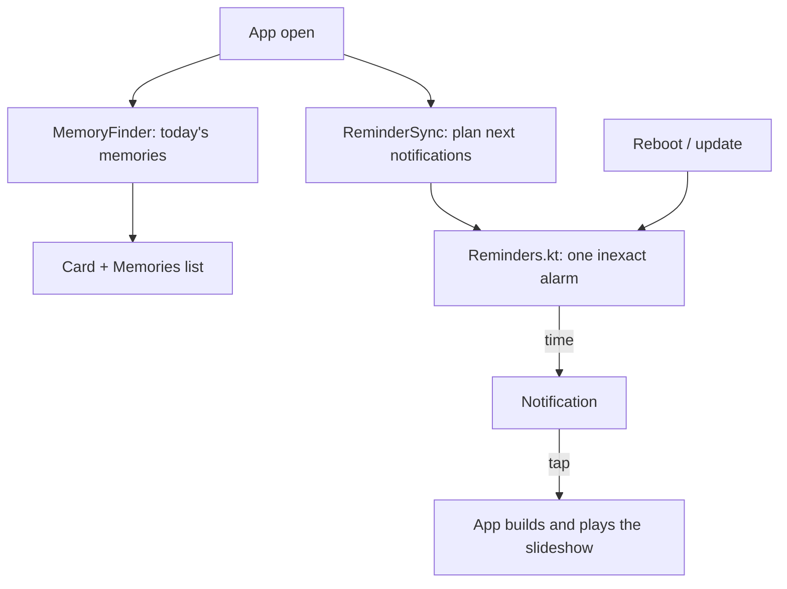

# Memories and rituals

Automatic memories ("This week, 1 year ago") built from the capture dates while the app is open, a weekly or monthly notification, and rituals: recurring slideshows the user schedules. Nothing runs in the background.

Last updated: 2026-11-04 — Visual refresh

## Purpose

Bring old photos back without the user looking for them, as the product owner asked on 2026-11-01 (Q5): a card in the app and a small notification once a week, **without any background task**. Rituals are slideshows the user schedules, e.g. "every Sunday at 7 pm: the week's photos" ([ADR 0027](../decisions/0027-notifications-without-background-work.md)).

## User flows

1. **Memory card**: at the top of the Camera tab, today's memories (several side by side). A tap plays the memory ([slideshow.md](slideshow.md)), with *Save* in the player; ✕ dismisses it (snackbar with *Undo*).
2. **Memories list**: Albums tab → Slideshows → **Memories** (shown once a memory was found). Every memory met so far and not dismissed, most recently found first; same tap and ✕.
3. **Settings → Slideshows and memories**:
   - **Memories**: *Off* / *Every week* (default) / *Every month*. *Off* hides the card and stops the notification.
   - **Notification** (off by default): turning it on asks for the notification permission on Android 13+. Then the day (a weekday, or a day of the month from 1 to 28) and the time; default Sunday 7 pm.
   - **Rituals** → the rituals page; **Slideshow defaults** → the options sheet.
4. **Rituals page**: each ritual with its time ("Every Sunday at 19:00"), an on / off switch and a menu (*Play now*, *Delete* with *Undo*). **New ritual**: what (*The week's photos*, *The month's photos*, *A saved slideshow*, *An album*) and when (every week or month, day, time). Saving an active ritual asks for the notification permission when needed.
5. **Notification**: "Your memories are ready — This week, 1 year ago · 24 photos", or "Your slideshow is ready — The week's photos". A tap opens the app, which builds the slideshow then and plays it. For memories: today's first memory, or the *Memories* list when there is none any more.

## How memories are found

`MemoryFinder.find(day)` ([memory_finder.dart](../../lib/features/memories/memory_finder.dart)), with the periods and rules of [memories.dart](../../lib/analysis/memories.dart):

| Rule | Value | Why |
| --- | --- | --- |
| Photos | The camera's photos (`DCIM/Camera/`, as the Camera tab) | Leaves out screenshots, received and downloaded images. |
| Good photos | Not trashed, not blurry or dark, one per duplicate group (the best) | The same rules as a slideshow with *Skip duplicates and blurry photos*. |
| Years | 1 year back to the oldest camera photo | |
| **This week** | Monday to Sunday of the week holding the same date N years ago; at least `minWeekPhotos` = **8** good photos | A shorter slideshow is a few seconds long. |
| **On this day** | The same date N years ago (29 February → 1 March); at least `minDayPhotos` = **6** | A day with that many photos was usually an event. |
| One per year | The day when it qualifies, otherwise the week | Avoids two cards showing the same photos. |

Memories are found once the media index is ready, and again when a duplicate scan ends (it measures blur and finds duplicates). Each new memory is stored in `memories` (key, kind, years, period, count, when found) so it stays in the list; only the period is stored, and its photos are read again when it plays.

The thresholds are first values, to adjust on real libraries (decision of 2026-11-03).

## Notifications without background work

- `ReminderSync` ([reminder_planner.dart](../../lib/features/memories/reminder_planner.dart)), watched by the home shell, plans the notifications once the index is ready at launch and whenever the memories settings, the language, the rituals, the saved slideshows or the albums change (after 0.5 s, so changes arriving together plan once).
- `planReminders`: for memories, the next 8 weekly or 6 monthly times **that have memories** (asked to `MemoryFinder` for each date); for each active ritual, its next 8 or 6 times ([schedule.dart](../../lib/analysis/schedule.dart)).
- `ReminderService.schedule` hands them to Android, which shows them at their time and sets them again after a reboot ([platform-android.md](../platform-android.md#notifications-at-set-times)). Times may be a few minutes late (inexact alarm, no special permission).
- Payloads: `memories`, `ritual:<id>`. The home shell opens them on a tap, at launch (`takeLaunchPayload`) or while the app runs (`taps`).

## Look

Memory cards of 216 × 150 dp with a large title over the photo ([mockup](../design-assets/mockups/screens/02-grid-dark.png)); the status bar icon is the rosace ([mockup](../design-assets/mockups/screens/10-rituals.png)).

## Screens and widgets

| Widget | File |
| --- | --- |
| `MemoryCards`, `MemoryCard`, `dismissMemory`, `memoryDateLabel` | [memory_card.dart](../../lib/features/memories/memory_card.dart) |
| `MemoriesScreen` (route `/albums/memories`) | [memories_screen.dart](../../lib/features/memories/memories_screen.dart) |
| `RitualsScreen` (route `/settings/rituals`), `RitualSheet`, `RecurringTimeEditor`, `ensureNotifications` | [rituals_screen.dart](../../lib/features/memories/rituals_screen.dart) |
| `MemoriesSettings` | [memories_settings.dart](../../lib/features/memories/memories_settings.dart) |
| Notification taps | [home_shell.dart](../../lib/core/router/home_shell.dart) |

## State and data

| Part | File | Role |
| --- | --- | --- |
| `Memory`, `MemoryKind` | [memory.dart](../../lib/domain/memory.dart) | A memory and its selection (camera photos of its period). |
| `Ritual`, `RecurringTime`, `Repeat`, `RitualContent` | [ritual.dart](../../lib/domain/ritual.dart) | What a ritual plays and when. |
| `memories`, `rituals` | [tables.dart](../../lib/core/database/tables.dart) | Schema version 7 ([database.md](../database.md#memories)). |
| `MemoryRepository` | [memory_repository.dart](../../lib/core/database/memory_repository.dart) | Record, list, dismiss memories; add, change, delete and restore rituals. |
| `todaysMemoriesProvider`, `memoryCardsProvider`, `slideshowBuilderProvider`, `memoryFinderProvider` | [memory_providers.dart](../../lib/features/memories/memory_providers.dart) | |
| `AppSettings.memories`, `memoriesWeekday`, `memoriesMonthDay`, `memoriesMinute`, `memoriesNotify` | [app_settings.dart](../../lib/core/settings/app_settings.dart) | [settings.md](settings.md). |
| `ReminderService` | [reminder_service.dart](../../lib/platform/reminder_service.dart) | Behind an interface; a fake in tests. |

Ritual periods: *The week's photos* are the camera's photos of the last seven days, today included; *The month's photos* those of the previous calendar month (`ritualDates`).

## Edge cases and error handling

- **Notifications refused**: a snackbar says so, with *Settings*; the memory notification switch stays off; the card still shows.
- **A ritual whose album or slideshow was deleted**: shown as "Deleted slideshow or album"; its notification plays "Nothing to show".
- **A memory notification tapped when the memory is gone** (photos trashed since): the *Memories* list opens.
- **The app not opened for two months**: weekly notifications stop until the next launch, which plans them again.
- **Time zone or daylight saving changes**: times are local; the next launch plans them again.

## Tests

- [memories_test.dart](../../test/analysis/memories_test.dart): weeks from Monday, 29 February, periods back to the oldest photo, one memory per year with the day first.
- [schedule_test.dart](../../test/analysis/schedule_test.dart): weekly and monthly times, today when still ahead, ranges, ritual periods.
- [slideshow_repository_test.dart](../../test/core/database/slideshow_repository_test.dart): memories recorded once and kept dismissed; rituals added, changed, deleted and restored.
- [slideshow_builder_test.dart](../../test/features/slideshow/slideshow_builder_test.dart): the finder picks the day, else the week, ignores screenshots and short years.
- [reminder_planner_test.dart](../../test/features/memories/reminder_planner_test.dart): memory notifications only on days with memories, none while off, every time of an active ritual, payloads.
- [slideshow_flow_test.dart](../../test/features/slideshow/slideshow_flow_test.dart): the card plays a memory, ✕ and *Undo*, no card while memories are off.
- [dependency_rules_test.dart](../../test/architecture/dependency_rules_test.dart): the receiver reads neither MediaStore nor the database.

## Known limitations / future work

- Trips (from the locations of the map) and a person over the years (with M10) are kept in mind, not built.
- Memories use the camera folder only, photos only; videos of the camera may join later.
- The thresholds (8 and 6 good photos) are to be checked on real libraries.
