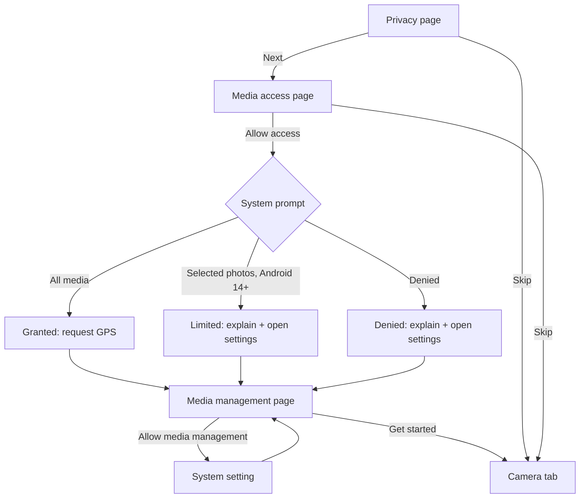

# Onboarding

First-launch flow that states the privacy promise and asks for the permissions the app needs.

Last updated: 2026-11-04 — Visual refresh

## Purpose

On first launch, the user learns that their photos never leave the device, grants access to their media and to GPS metadata, and can optionally grant "Media management" to avoid a confirmation prompt on every delete or favorite. The app stays usable whatever the user grants.

## User flows

1. **Privacy page**: "Your photos never leave your device." The user taps *Next*.
2. **Media access page**: the user taps *Allow access*. The system asks for photos and videos, then for GPS metadata if media access was given.
3. **Media management page** (optional): *Allow media management* opens the system setting. The user returns and taps *Get started*.
4. Onboarding is marked complete and the app opens the Camera tab. It is never shown again.

*Skip* at the top finishes onboarding immediately from the first two pages.

## Look

The first page is a poster: sun background, large mark appearing petal by petal, big headline, ink button. Pages 2 and 3 share its layout on `surface`, with the mark in the empty state colors. Above 150 % text size the mark is left out so the text stays readable. [Mockup](../design-assets/mockups/screens/01-onboarding.png).

## Screens and widgets

| Widget | File |
| --- | --- |
| `OnboardingScreen` (pages, dots, buttons) | [onboarding_screen.dart](../../lib/features/onboarding/onboarding_screen.dart) |

## State and data

| Item | File | Role |
| --- | --- | --- |
| `OnboardingState` (freezed) | [onboarding_controller.dart](../../lib/features/onboarding/onboarding_controller.dart) | Current page, media access result, request in progress. |
| `OnboardingController` | same | Requests permissions, opens settings. |
| `OnboardingCompleted` | same | Completion flag; the router redirects on it. |
| `PermissionService` | [permission_service.dart](../../lib/platform/permission_service.dart) | Media and GPS permissions. |
| `PlatformBridge` | [platform_bridge.dart](../../lib/platform/platform_bridge.dart) | "Media management" settings. |
| `settings.onboarding_completed` | [database.md](../database.md#settings) | Persisted flag. |

## Edge cases and error handling

- **Partial access (Android 14+)**: shown as "Only some of your media is shared", with a button to the app's settings.
- **Denied**: the user can continue; a message says the permission can be changed later in Settings.
- **"Media management" unavailable** (Android 11, or no settings screen on the device): the button does nothing and the app falls back to MediaStore confirmation prompts.
- **App killed during onboarding**: the flag is only written at the end, so onboarding restarts from the first page.
- The ad consent form (M11) is shown after onboarding, never before the permission pages.

## Tests

- [onboarding_controller_test.dart](../../test/features/onboarding/onboarding_controller_test.dart): granted, limited and denied results; GPS requested only with media access; completion persisted.
- [onboarding_screen_test.dart](../../test/features/onboarding/onboarding_screen_test.dart): privacy promise shown, full flow to the Camera tab, skip, returning users.

## Known limitations / future work

- Illustrations are Material icons; custom artwork in M12.
- Permission status and changes from Settings come in M2.
- Partial access detection needs a check on a real Android 14 device.
