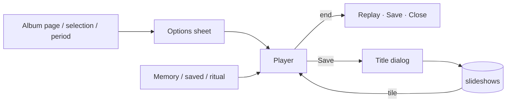

# Slideshows

Full-screen slideshows of an album, a selection, a period or a memory, with a crossfade or a slow zoom, muted videos and music; saved on the user's tap to play again.

Last updated: 2026-11-04 — Visual refresh spec

## Purpose

Look back at photos without swiping through them one by one, as the product owner asked on 2026-11-01 (answers Q6 to Q8 in [progress.md](../progress.md#new-features--decisions-2026-11-01)). The app draws the slideshow as it plays and saves it as a list, never as a video file ([ADR 0026](../decisions/0026-saved-slideshows-without-video.md)).

## User flows

1. **Start**:
   - the **Slideshow** button (▶ in a frame) in the title of every album page: folders, All media, Favorites, user albums, search results, an area of the map. It plays what the page shows, its date range included;
   - a **selection** in any timeline: More (⋮) → *Slideshow*;
   - **Albums tab → Slideshows → Slideshow** (a custom slideshow): the options sheet asks first for an **album** (*All media* by default, Favorites, the user's albums, then the device folders; typing narrows the list) and a **period** (all time, last 7 or 30 days, this year, last year, or a custom range, as in the sort sheet; last 30 days by default). The title reads "Trip · Last 30 days" (product owner, 2026-11-04);
   - a **memory** card or the *Memories* list ([memories.md](memories.md)), a **saved slideshow** tile, or a **ritual** notification: these play at once, without the options sheet.
2. **Options sheet** (remembered for the next one): time per photo (3, 5 or 8 s), transition (*Crossfade* or *Slow zoom*), order (*By date* or *Shuffled*), *Include videos* (muted, 10 s at most), *Skip duplicates and blurry photos* (on by default), music. **Start**.
3. **Playing**: full screen, black, the screen kept on and the system bars hidden. A tap shows the controls for 3 s: close, title, *Save*, position ("3 of 24"), previous, pause / play, next. Pausing also pauses the music and the zoom.
4. **End**: the music fades out over 2 s; **Replay**, **Save** (unless saved), **Close**.
5. **Save**: a title dialog (the album or period name is proposed), then a snackbar "Saved in Albums → Slideshows". The slideshow is stored with its items in playing order and its options.
6. **Albums tab → Slideshows**: a tap on a saved slideshow plays it with its own options; a long press offers *Play*, *Rename*, *Delete* (snackbar with *Undo*; the photos stay).

## Music

| Choice | How |
| --- | --- |
| None | Default. |
| Bundled tracks | `bundledTracks` in [slideshow.dart](../../lib/domain/slideshow.dart), assets under `assets/music/`, credited in About. **Empty for now**: the product owner picks 2 or 3 CC0 tracks, then they are added with their credits (decision of 2026-11-03). The sheet says "Music bundled with the app is coming soon." |
| Track from the phone | *Choose a track on the phone* opens the system file picker (`ACTION_OPEN_DOCUMENT`, `audio/*`). No audio permission: the app gets read access to that file only, kept with a persistable permission and given back when neither the defaults nor a saved slideshow use it. |

The music loops, pauses with the slideshow and fades out at the end. A track that was moved or deleted plays nothing and a snackbar says so; the slideshow goes on.

## Which items play

`SlideshowBuilder.goodItems` reads the selection from the media index, **oldest first**, and leaves out:

- trashed items;
- videos, when *Include videos* is off;
- with *Skip duplicates and blurry photos*: photos of the blurry and dark cleanup list (`MediaSelection.goodOnly`, the same rule as [cleanup.md](cleanup.md)) and, in each duplicate group, every item but the best one ([duplicates.md](duplicates.md)). Unmeasured photos are kept.

*Shuffled* shuffles that list once. A saved slideshow plays its saved list as it is, skipping items trashed or no longer on the device.

## Planned look

Controls with a thin position bar and round glass buttons; an end screen with the first photo ([mockup](../design-assets/mockups/screens/18-slideshow-end.png)). Not built yet: [visual refresh](../visual-refresh.md), [mockup](../design-assets/mockups/screens/06-memory-player.png).

## Screens and widgets

| Widget | File |
| --- | --- |
| `SlideshowScreen` (route `/slideshow`, `SlideshowArgs` as `extra`), `_Slide` (photo with zoom, muted video), `_Controls`, `_EndOverlay` | [slideshow_screen.dart](../../lib/features/slideshow/slideshow_screen.dart) |
| `SlideshowOptionsSheet` (with `_AlbumMenu` for a custom slideshow), `startSlideshow`, `startPeriodSlideshow`, `playSlideshow`, `saveSlideshow`, rename, delete, `releaseUnusedMusic` | [slideshow_actions.dart](../../lib/features/slideshow/slideshow_actions.dart) |
| `SlideshowSource` (selection, picked items, saved, memory, ritual), `SlideshowBuilder` | [slideshow_builder.dart](../../lib/features/slideshow/slideshow_builder.dart) |
| Title button (`slideshowTitle`), selection action | [media_timeline_view.dart](../../lib/features/library/media_timeline_view.dart) |
| *Slideshows* section of the Albums tab, saved slideshow menu | [albums_screen.dart](../../lib/features/library/albums_screen.dart) |
| *Slideshow defaults* in Settings | [memories_settings.dart](../../lib/features/memories/memories_settings.dart) |

## State and data

| Part | File | Role |
| --- | --- | --- |
| `SlideshowOptions`, `SlideshowMusic`, `SavedSlideshow` | [slideshow.dart](../../lib/domain/slideshow.dart) | Options with their JSON form (`encode` / `decode`, invalid values fall back to the defaults). |
| `slideshows`, `slideshow_items` | [tables.dart](../../lib/core/database/tables.dart) | Schema version 7 ([database.md](../database.md#slideshows)). |
| `SlideshowRepository` | [slideshow_repository.dart](../../lib/core/database/slideshow_repository.dart) | Saved slideshows with count and cover, save, items in order, rename, delete and restore, `forget`, `deviceMusicUris`. |
| `AppSettings.slideshowOptions` | [app_settings.dart](../../lib/core/settings/app_settings.dart) | The defaults (`slideshow_options` key). |
| `MusicPlayer`, `PlatformBridge.setKeepScreenOn` | [music_player.dart](../../lib/platform/music_player.dart), [platform_bridge.dart](../../lib/platform/platform_bridge.dart) | Music and screen, behind interfaces ([platform-android.md](../platform-android.md)). |

Items deleted for good leave every saved slideshow (`MediaActions.deleteForever` → `forget`).

## Edge cases and error handling

- **Nothing to play** (an empty period, every item trashed, a ritual whose album was deleted): "Nothing to show" and *Close*.
- **A video that cannot be read**: skipped at once.
- **A missing music file**: the slideshow plays without music, with a snackbar.
- **Leaving the player** (back, *Close*): music stopped, screen allowed to sleep again, system bars back.
- **Saving while playing** pauses during the dialog and resumes after.

## Tests

- [slideshow_test.dart](../../test/domain/slideshow_test.dart): options round-trip, invalid text gives the defaults.
- [slideshow_repository_test.dart](../../test/core/database/slideshow_repository_test.dart): order and options kept, newest first, trash not counted, rename, delete and undo, `forget`.
- [slideshow_builder_test.dart](../../test/features/slideshow/slideshow_builder_test.dart): oldest first without trashed, blurry or duplicate items, videos left out, shuffle, a saved slideshow's order, a ritual with a deleted album.
- [cleanup_selection_test.dart](../../test/core/database/cleanup_selection_test.dart): `goodOnly` leaves out exactly the blurry and dark list.
- [slideshow_flow_test.dart](../../test/features/slideshow/slideshow_flow_test.dart): a selection → options → player (screen kept on, music, controls, pause) → end → save → replay from the Albums tab; a custom slideshow of the album and period picked, closed while playing.

## Known limitations / future work

- **Bundled music** waits for the product owner's choice of CC0 tracks.
- **Sharing as a video** and **casting to a TV** (Q8): later; a saved slideshow already holds its items and options for a renderer.
- No manual reordering of a saved slideshow, and no editing of its options after saving.
- The slow zoom works on a screen-sized preview; zooming deep into a large photo would need the full image.
