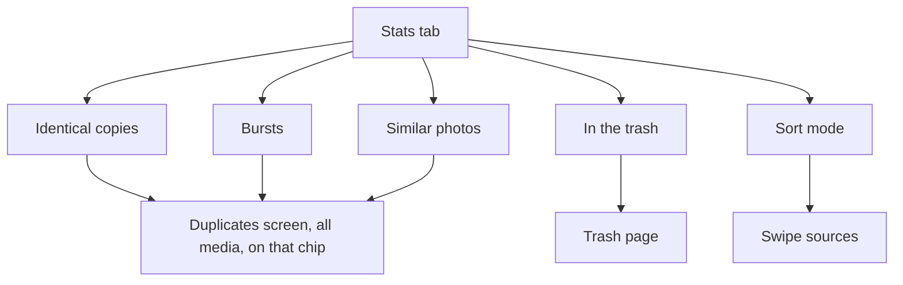

# Stats

The Stats tab: the storage dashboard. How much space the photos and videos take, how much cleaning could free, and that space by category.

Last updated: 2026-11-05 — Milestone M11

## Purpose

Show at a glance whether cleaning is worth it, and lead to the tool that does it. The brief calls this tab "Clean" and asks for "a storage dashboard: total space used by media and reclaimable space per category"; the app names it **Stats** ([ADR 0008](../decisions/0008-navigation-and-visual-identity.md)).

## User flows

1. **Stats tab** (fourth icon of the bar).
2. The accent card shows **Space you could free** in large type, *Out of 52 GB used by your photos and videos*, a gauge of that share, and the split *Photos 12 GB · Videos 40 GB*. While the analysis runs, *Your library is being analyzed. The value grows as it goes.*
3. The first card lists what can be freed now, each with its item count and size:
   - **Identical copies**: extra copies of the same file → opens the duplicates screen for the whole library, on the *Identical copies* chip.
   - **Bursts**: burst shots other than the best → the same screen, on *Bursts*.
   - **Similar photos**: photos suggested for the trash among look-alikes → the same screen, on *Similar photos*.
   - **In the trash**: freed when the trash is emptied → the Trash page (Albums tab).
4. The **Sort mode** card opens the swipe mode ([swipe.md](swipe.md)).
5. The last card lists **Old screenshots**, **Large videos** and **Blurry photos** with their count and size, each opening its cleanup list ([cleanup.md](cleanup.md)).

## What is counted

| Value | Rule |
| --- | --- |
| Used | Size of every photo and video outside the trash, from the media index. |
| Identical copies | Items suggested for the trash in exact groups of the whole library: every member but the best. |
| Bursts | The same in burst groups, leaving out items already counted as identical copies. |
| Similar photos | The same in similar groups, leaving out items already counted above. |
| Old screenshots | Screenshots older than the age set in Settings, leaving out items already counted above. |
| Large videos | Videos from the size set in Settings, leaving out items already counted above. |
| Blurry photos | Blurry or very dark photos, leaving out items already counted above. |
| In the trash | Every trashed item. |
| Space you could free | Every category above + trash. |

Each item counts once. The gauge shows that sum against the used space, as eight petals; with a large trash it can be full, since trashed items are no longer part of the used space but still take room.

The counts follow the default picks, not changes made on the duplicates screen: the screen's picks are not saved.

## Look

The hero card has a gauge in the shape of the logo instead of a bar, and the categories are a mosaic of tiles; every category stays ([gauge rules](../visual-refresh.md#the-stats-gauge)). [Mockups](../design-assets/mockups/screens/04-stats-dark.png).

## Screens and widgets

| Widget | File |
| --- | --- |
| `StatsScreen`, hero card, category tiles | [stats_screen.dart](../../lib/features/stats/stats_screen.dart) |

## State and data

| Item | File | Role |
| --- | --- | --- |
| `storageSummaryProvider` | [storage_summary.dart](../../lib/features/stats/storage_summary.dart) | Recomputed after each sync, scan and trash change. |
| `summarize` | same | Pure function: totals, duplicate groups and trash to the dashboard's values. |
| `MediaIndexRepository.totals` | [media_index_repository.dart](../../lib/core/database/media_index_repository.dart) | Count and size of photos and videos outside the trash, one SQL query. |
| `duplicateGroupsProvider` | [duplicates.dart](../../lib/core/media/duplicates.dart) | Groups of the whole library. |

## Edge cases and error handling

- **While the values load**: every value shows "—".
- **Empty library or nothing to clean**: 0 B, no lit petal, "Nothing" under each category.
- **Analysis in progress**: the values grow as groups are found; the hint on the card says so, followed by "Analyzing: N of M items".
- **Identical copies**, **Bursts** and **Similar photos** open the duplicates screen of the whole library on that kind's chip (`/duplicates?kind=exact|burst|similar`).

## Tests

- [storage_summary_test.dart](../../test/features/stats/storage_summary_test.dart): each kind of group counted, an item in two groups counted once, the trash, an empty library.
- [similar_flow_test.dart](../../test/features/duplicates/similar_flow_test.dart): the tab shows the values and opens the duplicates screen.
- [navigation_test.dart](../../test/core/router/navigation_test.dart): the tab and its categories.

## Known limitations / future work

- Opening the trash switches to the Albums tab, where the Trash page lives.
