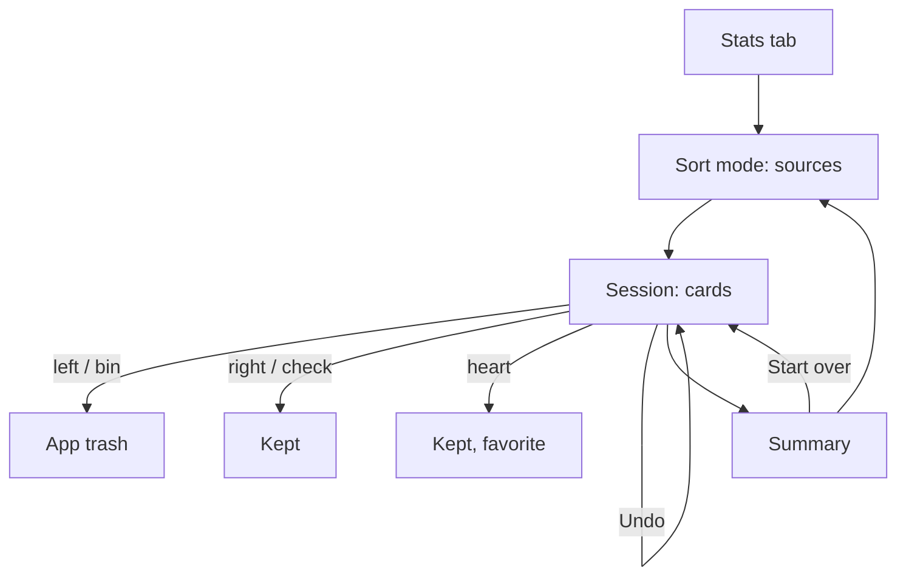

# Sort mode (swipe)

Sort photos one at a time: swipe left to move a photo to the trash, right to keep it. Opened from the Stats tab.

Last updated: 2026-11-05 — Milestone M11

## Purpose

The brief's swipe mode: "full-screen cards, one at a time, from a chosen source (a folder, "All photos", a month, blurry photos…). Left = trash, right = keep. Equivalent buttons at the bottom for users who don't swipe, plus a favorite button. An "Undo" button that is always visible, undoing the last action with an animation bringing the card back, multiple levels deep. Sessions are resumable (saved in `swipe_history`), with progress ("42 / 300") and a summary at the end of the session."

## User flows

1. **Stats tab** → **Sort mode** card ("Swipe left to trash, right to keep").
2. The **sources** page: a short help text, then
   - *Start with*: **All photos**, **Blurry photos**, **Old screenshots**;
   - *By month*: every month with photos or videos, newest first, with its item count;
   - *By folder*: every device folder, with its item count.

   A source with a session in progress reads "*42 sorted · resume*".
3. The **session** opens full screen, above the tabs: the source's name, **Undo** (always visible, greyed out until a first decision), the progress bar and "*42 / 300*", then the current card over the next one.
4. **Swipe left** (or the red bin button): the item goes to the app trash. **Swipe right** (or the check button): it is kept. The **heart** button keeps it and marks it as a favorite (the system asks to confirm). While dragging, a *TRASH* or *KEEP* stamp shows and the card tilts; released before 30 % of the width (and without a flick), it springs back.
5. **Undo** brings the last card back, flying in from the side it left: a trashed item is restored, a new favorite is unmarked. It works as many times as there are decisions, also on the summary and after leaving and coming back.
6. **Close** (×) at any time: the next visit to the same source resumes at the first card not sorted.
7. The **summary** at the end: "All sorted!", how many were moved to the trash (with the space freed), kept, and kept as favorites; **Done**, **Open the trash**, **Start over**.

## Rules

| Source | Items | Key in `swipe_history` |
| --- | --- | --- |
| All photos | Every photo | `all` |
| Blurry photos | The [Blurry photos](cleanup.md) list | `blurry` |
| Old screenshots | The [Old screenshots](cleanup.md) list, with the age set in Settings | `screenshots` |
| A month | Photos and videos of that month, by the date the timelines use | `month:2024-03` |
| A folder | Photos and videos of that folder | `folder:<bucket id>` |

- **Oldest first**, in every source (the product owner's choice, 2026-10-27): old photos are the most often forgotten.
- **One session per source.** Each decision is saved at once (`swipe_history`: session key, order, item, action); a session shows the items of its source not decided yet and not in the trash. Items added since the last visit join the session; items trashed elsewhere leave it.
- **Trash** goes through the app trash ([trash.md](trash.md)), like every delete; the item can be restored from there for the retention period.
- **Undo** removes the last row of the session and reverses its effect. Writes to `swipe_history` run one after the other, so an undo right after a swipe removes that swipe.
- **Start over** forgets the session's decisions; trashed items stay in the trash and do not come back.
- Videos show their thumbnail with a play icon; they are not played.

## Look

Always dark. The card fills the screen, with a floating glass bar for the buttons; stamps in sentence case, *Keep* in citron and *Trash* in `error`. The end is a full citron screen revealed from the side the last card left by, with the complete mark. Mockups: [session](../design-assets/mockups/screens/05-sort.png), [end](../design-assets/mockups/screens/08-sort-summary.png).

## Screens and widgets

| Widget | File |
| --- | --- |
| `SwipeSourcesScreen` | [swipe_sources_screen.dart](../../lib/features/swipe/swipe_sources_screen.dart) |
| `SwipeScreen`, `_SwipeDeck` (drag, fly-away and come-back animations), `_Card`, `_Buttons`, `_Summary` | [swipe_screen.dart](../../lib/features/swipe/swipe_screen.dart) |
| Sort mode card | [stats_screen.dart](../../lib/features/stats/stats_screen.dart) |

Routes: `/stats/swipe` (sources, in the Stats branch) and `/swipe?source=<key>&name=<title>` (session, above the tabs; an unknown key goes back to Stats).

## State and data

| Item | File | Role |
| --- | --- | --- |
| `SwipeSource`, `swipeSelectionProvider`, `swipeMonthsProvider`, `swipeProgressProvider` | [swipe_source.dart](../../lib/features/swipe/swipe_source.dart) | Sources, their items oldest first, the months, the progress of each session. |
| `SwipeSession` (`swipeSessionProvider`), `SwipeSessionState` | [swipe_session.dart](../../lib/features/swipe/swipe_session.dart) | Cards left, decisions, decide, undo, start over. |
| `SwipeRepository` | [swipe_repository.dart](../../lib/core/database/swipe_repository.dart) | Reads and writes `swipe_history` ([database.md](../database.md)). |
| `MediaIndexRepository.months` | [media_index_repository.dart](../../lib/core/database/media_index_repository.dart) | Months with items and their count, one SQL query. |

## Edge cases and error handling

- **Empty source**: "Nothing to sort here".
- **Loading error**: "The photos could not be loaded."
- **Favorite declined** in the system prompt: the card is still kept; a snackbar says favorites were not changed.
- **Fast swipes**: a card already flying ignores new drags and buttons until it is gone.
- **An item deleted from the device** after it was decided leaves its session (cascade on `swipe_history`).

## Tests

- [swipe_session_test.dart](../../test/features/swipe/swipe_session_test.dart): oldest first and videos left out of All photos, the three actions, multi-level undo (trash restored, favorite unmarked), resume with an undo right after a swipe, start over, source keys, month source and months.
- [swipe_flow_test.dart](../../test/features/swipe/swipe_flow_test.dart): from the Stats tab, swipe left and fling right, undo twice, a short drag springing back, buttons and summary, closing and resuming.

## Known limitations / future work

- No entry from an album page or a month header yet; the Stats tab is the only way in.
- A session keeps no list of its items: a month session resumes with the items of that month at the time, so a photo whose date is corrected moves to its new month.
- The brief's ad rules exclude swipe mode: no ad is ever shown here.
