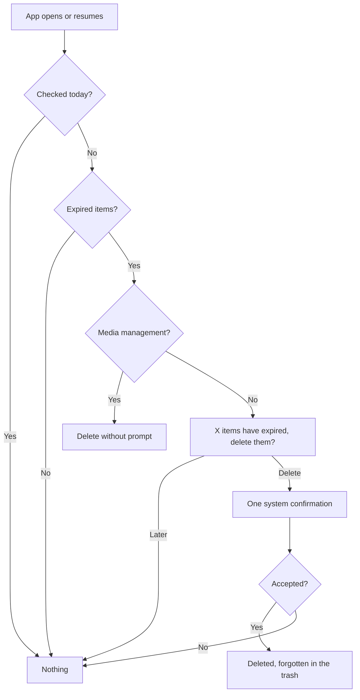

# Trash

The app's own trash: every delete in Clean Gallery lands here first, and items are deleted from the device only after the retention period, with the user's confirmation.

Last updated: 2026-10-25 — Milestone M2

## Purpose

Deleting from the viewer, a selection or (later) cleanup tools never removes a file at once: it records the item in the trash, which hides it everywhere in the app. The user can restore it, delete it for good, or let it expire after the retention period set in Settings (1 to 90 days, 30 by default).

## User flows

1. **Move to trash** from the viewer (top bar) or a selection (selection bar): the items disappear and a snackbar offers *Undo*.
2. **Albums → Trash**: grid of trashed items with the days left on each.
3. Tap items to select them, then **Restore** or **Delete for good**; or **Empty trash** at the top.
4. **Delete for good**: the app asks for confirmation, then Android shows one system confirmation for the whole batch (none with "Media management").
5. **Expiry**: once a day, at launch or when the app comes back to the foreground, expired items are offered for deletion.

## Screens and widgets

| Widget | File |
| --- | --- |
| `TrashScreen` (`/albums/trash`) | [trash_screen.dart](../../lib/features/trash/trash_screen.dart) |
| `offerExpiredTrashPurge` | [trash_purge.dart](../../lib/features/trash/trash_purge.dart) |
| Trash tile in Albums | [albums_screen.dart](../../lib/features/library/albums_screen.dart) |
| `trashWithUndo` | [media_actions.dart](../../lib/core/media/media_actions.dart) |

## State and data

| Item | File | Role |
| --- | --- | --- |
| `TrashRepository` | [trash_repository.dart](../../lib/core/database/trash_repository.dart) | Trash, restore, expired items, forget after deletion. |
| `trashedIdsProvider`, `trashItemsProvider` | [providers.dart](../../lib/core/providers.dart) | Live trash content; every media list hides the trashed ids. |
| `MediaActions` | [media_actions.dart](../../lib/core/media/media_actions.dart) | Trash, restore, delete for good. |
| `trash_entries`, `assets` tables | [database.md](../database.md#trash_entries) | One entry per item; a minimal asset row is inserted with it. |
| `trash_retention_days`, `last_purge_check` settings | [database.md](../database.md#settings) | Retention and once-a-day check. |

Trashed items are hidden in two ways:

- **Timelines and the viewer** filter them out of the loaded list in memory (`visibleMediaListProvider`), so trashing and undoing are instant and never query MediaStore.
- **Album counts and covers** exclude them in the MediaStore query itself (`_id NOT IN (…)`, folder summaries included), so the Albums tab stays right ([platform-android.md](../platform-android.md#media-access)).

## Edge cases and error handling

- **Trashing an item twice** keeps a single entry.
- **Declining the system confirmation**: nothing is deleted; the trash says so.
- **"Later" on the expiry prompt**: asked again the next day.
- **Item deleted by another app while in the trash**: the system deletion of the batch skips it; the entry remains until the next successful deletion. To be handled with indexing (M3).
- **Retention changed**: applies to items trashed afterwards; existing entries keep their expiry date.

## Tests

- [trash_repository_test.dart](../../test/core/database/trash_repository_test.dart): order, live ids, expiry, forget, duplicates, days left.
- [trash_flow_test.dart](../../test/features/trash/trash_flow_test.dart): trash from the viewer with undo, Trash screen with days left, restore, delete after confirming, declined deletion, expiry prompt, silent purge with Media management, Trash album count.
- [selection_test.dart](../../test/features/library/selection_test.dart): trash a selection and undo.

## Known limitations / future work

- **No background purge**: the brief asks for a daily WorkManager task, but Android only lets an app delete other apps' media through a system request launched from a visible screen, even with "Media management". The product owner accepted the purge at launch and resume ([ADR 0013](../decisions/0013-trash-purge-without-background-job.md)).
- **Trashed items stay visible in other galleries** until deleted for good, since the file is untouched. Using Android's own trash (`createTrashRequest`) was considered: it would hide them everywhere, but asks for a confirmation on every trash without Media management and has a fixed 30-day retention. The product owner chose to keep the app trash (2026-10-25), useful if Clean Gallery becomes the main gallery.
- Cleanup tools (M5) and the duplicates screen (M3) will also trash through `MediaActions`.
