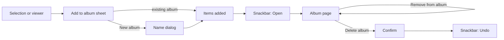

# User albums

Albums the user creates and fills from any timeline or the viewer. An album is only a list in the app's database: no file is ever moved, copied or deleted for it.

Last updated: 2026-11-01 — Milestone M8

## Purpose

Gather photos and videos from anywhere in the library (a trip, a person, a project) without touching the files, as the product owner asked on 2026-11-01: "the app moves no file, so if an album is deleted or the app is uninstalled, the photo is not deleted". A photo can be in several albums and stays in its folder and in the Camera timeline ([ADR 0025](../decisions/0025-user-albums-in-the-database.md)).

## User flows

1. **Albums tab → My albums**, between the virtual albums (All media, Favorites, Map, Trash) and the device folders. Without any album: one line ("Gather photos and videos without moving them…") and a **New album** button. With albums: a **New album** tile first, then the albums, newest first, each with its cover and count.
2. **New album**: a name dialog (60 characters at most). An empty name, or a name another album has (ignoring case), is refused under the field. *Create* opens the empty album, whose empty state explains how to fill it.
3. **Add to album** from a selection, in any timeline (Camera, Videos, album and folder pages, search results, cleanup lists): the selection bar's **More** menu (⋮) → *Add to album*; or from the viewer, the **Add to album** button of the action bar.
   - A sheet titled *Add N items to an album*: **New album** (name dialog, then the items are added), then each album with its count, or *Already in it* / *N already in it* when the items are partly or all there.
   - Then a snackbar: *N items added to Trip*, or *Already in Trip* when nothing was new, with **Open**.
4. **Album page**: a timeline like a folder page (sort and dates, search, selection, viewer). The title bar's menu (⋮, *Album options*): **Rename** (same dialog and rules) and **Delete album**.
5. **Selection on an album page**: the usual actions, and in the More menu **Remove from album** (snackbar with *Undo*; the files stay) and, for one item, **Use as cover**.
6. **Delete album**: a confirmation (*Delete "Trip"?* — "Only the album is deleted: its 3 items stay on your device, in their folders."), then the page closes and a snackbar offers *Undo*, which brings the album back with the same items and cover.

## Screens and widgets

| Widget | File |
| --- | --- |
| *My albums* section, `_NewAlbumTile` | [albums_screen.dart](../../lib/features/library/albums_screen.dart) |
| `UserAlbumScreen` (route `/albums/mine/<id>`) | [user_album_screen.dart](../../lib/features/user_albums/user_album_screen.dart) |
| `addToAlbum`, `createAlbum`, `askAlbumName`, the sheet and the name dialog | [user_album_actions.dart](../../lib/features/user_albums/user_album_actions.dart) |
| Selection bar with its More menu | [selection_bar.dart](../../lib/core/media/selection_bar.dart) |
| Timeline hooks: `headerActions`, `selectionActions`, `emptyBody` | [media_timeline_view.dart](../../lib/features/library/media_timeline_view.dart) |
| Viewer button | [viewer_screen.dart](../../lib/features/viewer/viewer_screen.dart) |

The selection bar holds four buttons next to the count on a phone; with more actions, the first three stay buttons (share, favorite, trash) and the others go in the **More** menu (add to album, select all, and the page's own actions).

## State and data

| Part | File | Role |
| --- | --- | --- |
| `user_albums`, `user_album_items` | [tables.dart](../../lib/core/database/tables.dart) | Schema version 6 ([database.md](../database.md#user_albums)). |
| `UserAlbumRepository` | [user_album_repository.dart](../../lib/core/database/user_album_repository.dart) | Albums with count and cover (a Drift stream), create, rename, add (returns how many were new), remove, cover, delete and restore, `containing`, `forget`. |
| `UserAlbum`, `MediaSelection.userAlbumId` | [album.dart](../../lib/domain/album.dart) | The album as listed; an album page is the selection of its items, so it gets every timeline feature. |
| `userAlbumsProvider`, `userAlbumItemChangesProvider` | [providers.dart](../../lib/core/providers.dart) | The list for the Albums tab and the sheet; a counter that makes album pages reload when items are added or removed. |
| `MediaIndexRepository._matches` | [media_index_repository.dart](../../lib/core/database/media_index_repository.dart) | `id IN (SELECT asset_id FROM user_album_items WHERE album_id = ?)`. |
| `viewKey` | [app_settings.dart](../../lib/core/settings/app_settings.dart) | Each album saves its own sort (`all::user<id>`). |

- **Count and cover** leave out trashed items and items missing from the index. The cover is the item chosen with *Use as cover* while it is in the album and shown, otherwise the newest item.
- **Items deleted for good** (from the trash) leave every album (`MediaActions.deleteForever` → `forget`).
- `user_album_items.asset_id` is **not a foreign key**: with limited access, or while the index is rebuilt, items leave the index without leaving the device, and their albums must keep them.

## Edge cases and error handling

- **Trashed items** disappear from their albums and come back when restored.
- **Limited access** (Android 14+): items not picked are not shown nor counted, and come back when access is widened.
- **The same items added twice**: nothing is duplicated; the snackbar says *Already in …*.
- **Deleting an album** never deletes a photo; *Undo* restores the same album id, so its saved sort comes back too.
- **Uninstalling the app** removes the albums (they live in the app's database) and nothing else.
- A **rebuilt MediaStore** (new version, ids pointing to other files) can make an album show other photos; this only happens after a system reset of the media database.

## Tests

- [user_album_repository_test.dart](../../test/core/database/user_album_repository_test.dart): empty album, newest first, adding counts only new items, an item in several albums, trash hidden and restored, items missing from the index kept, remove and forget without touching the index, chosen cover and fallback, rename, delete and restore.
- [app_database_test.dart](../../test/core/database/app_database_test.dart): migration 5 → 6, album deletion cascading to its items.
- [user_albums_test.dart](../../test/features/user_albums/user_albums_test.dart): the empty Albums tab and *New album*, empty name refused, adding a selection to a new album and opening it, *Already in it* and *N already in it*, the viewer's button, remove and undo, *Use as cover* offered for one item, rename and a taken name refused, delete with the photos still in Camera and undo.

## Known limitations / future work

- Albums are not visible to other gallery apps and are lost when the app is uninstalled; an export / import could come with M12.
- No manual order inside an album, and albums are listed newest first only.
- Slideshows start from album pages from M9 ([progress.md](../progress.md)).
