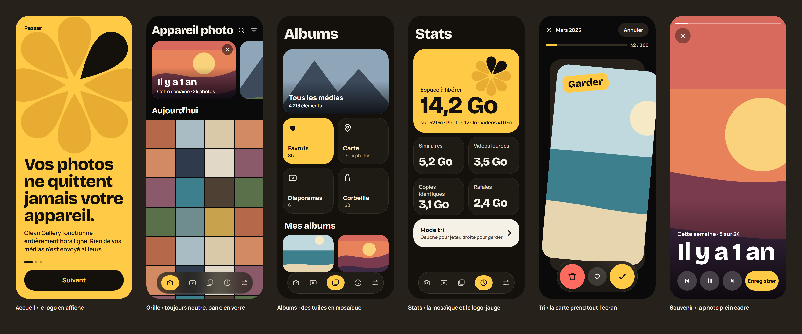
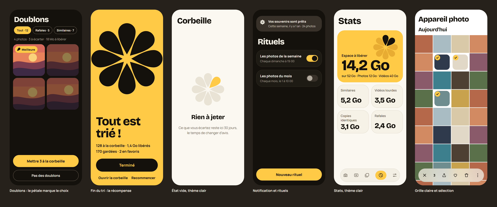
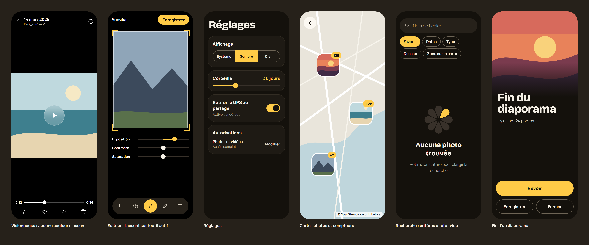

# Visual refresh

Implementation brief for moving the app to the Éclat Soleil identity: mockups, screen by screen changes, code to change, copy, order of work and what to check. Values live in [design.md](design.md), the reasons in [ADR 0028](decisions/0028-warm-eclat-identity.md).

Last updated: 2026-11-04 — Visual refresh

## Status and scope

Specified and approved by the product owner on 2026-11-04, **built on branch `visual-refresh`** the same day, before M10. The device checks are still to do ([testing.md](testing.md#visual-refresh--to-verify-on-a-device)).

- **In scope**: theme, fonts, layouts of the listed screens, empty states, motion, launcher and notification icons, launch screen.
- **Out of scope**: what features do, their rules and their data. A screen keeps every action and every piece of information it has today, even when a mockup leaves one out to stay readable. No new permission, no network, no new package is needed.
- **Not in the mockups**: ads (M11) and People (M10). They use the same tokens; see [Ads](#ads).

## Mockups

**The mockups show the earlier yellow accent `#FFCB47`**: the product owner changed the accent to golden citron after they were drawn, so they stay a reference for layouts, and [design.md](design.md#palette) for colors. Phones are drawn at 300 × 730 and exported at 2×. Photos are flat placeholders, numbers are examples, icons are approximations: use the Material icons of [design.md](design.md#navigation-bar). Text is in French because the mockups were reviewed in French. Sources, as plain HTML: [mockups/source/](design-assets/mockups/source/).

### Sheet 1: core screens

### Sheet 2: cleanup and light theme

### Sheet 3: photos and tools

### Reference

The accent and logo studies, kept to show what was compared: [accents](design-assets/mockups/00-warm-accents.png), [logos](design-assets/mockups/00-logo-treatments.png). **Soleil** and **Plein soleil** were chosen.

## Screens

Each screen also exists alone in [mockups/screens/](design-assets/mockups/screens/).

| Screen | Mockup | What changes | Stays as it is |
| --- | --- | --- | --- |
| Onboarding | [01](design-assets/mockups/screens/01-onboarding.png) | First page: citron background, large mark bleeding off the top right, `displayMedium` headline at the bottom, ink button. Pages 2 and 3: same layout on `surface`, with the mark in the empty state colors. | Steps, permissions, *Skip*, dots |
| Camera, Videos, album pages | [02](design-assets/mockups/screens/02-grid-dark.png), [12](design-assets/mockups/screens/12-grid-light-selection.png) | Neutral background, Bricolage titles and section headers, glass bar. | Grid, pinch, stacks, badges, selection, fast scroll |
| Memory card | [02](design-assets/mockups/screens/02-grid-dark.png) | 216 × 150 dp, 24 dp radius, `headlineSmall` title over the scrim, round ✕. | Several side by side, tap to play, Undo |
| Albums tab | [03](design-assets/mockups/screens/03-albums.png) | Mosaic: *All media* across the width (168 dp, cover and scrim), then Favorites (citron), Map, Slideshows, Trash. | Then *My albums* and *Folders*, each with name and count under the cover; banner place |
| Stats tab | [04](design-assets/mockups/screens/04-stats-dark.png), [11](design-assets/mockups/screens/11-stats-light.png) | Hero card with the gauge, a mosaic for the categories, *Sort mode* as a wide light tile. | All categories and destinations of [stats.md](features/stats.md), the Photos and Videos split, the analysis message |
| Sort session | [05](design-assets/mockups/screens/05-sort.png) | Card fills the screen, stamp in Bricolage (`Garder` in citron, `Corbeille` in `error`), floating glass bar for the three buttons. | Gestures, Undo always visible, progress, close |
| End of a sort | [08](design-assets/mockups/screens/08-sort-summary.png) | Citron screen, complete mark in ink, `displayMedium` title. | Counts, space freed, *Done*, *Open the trash*, *Start over* |
| Memory and slideshow player | [06](design-assets/mockups/screens/06-memory-player.png), [18](design-assets/mockups/screens/18-slideshow-end.png) | Controls shown on tap: thin position bar, `displayLarge` title, round glass buttons. End screen with the first photo fading into `surface`. | Photos keep their fit (the mockup's full-bleed placeholder is not a crop), timing, music, *Save* |
| Duplicates | [07](design-assets/mockups/screens/07-duplicates.png) | *Best* pill with a small petal, 18 dp radius in this review screen, others dimmed once picked. | Chips, sort, *Not duplicates*, *Clean all groups* |
| Empty states | [09](design-assets/mockups/screens/09-empty-trash-light.png), [17](design-assets/mockups/screens/17-search-empty.png) | The mark instead of the icon, see [Empty states](design.md#empty-states). | Their conditions and buttons |
| Rituals, notification | [10](design-assets/mockups/screens/10-rituals.png) | Tokens, new status bar icon. | Everything else |
| Viewer | [13](design-assets/mockups/screens/13-viewer-video.png) | No accent over the media, glass play button, white slider, pull down to close. | Actions, info panel, group strip, zoom |
| Editor, scanner | [14](design-assets/mockups/screens/14-editor.png) | Accent on the active tool, the active slider, the crop corners and *Save*; all other sliders neutral. | Tools and the paint functions |
| Settings | [15](design-assets/mockups/screens/15-settings.png) | Tokens, Bricolage title. | Sections |
| Map | [16](design-assets/mockups/screens/16-map.png) | Markers with a 3 dp white ring and a citron count. The tiles themselves stay as OpenStreetMap draws them. | Clusters, attribution |
| Search | [17](design-assets/mockups/screens/17-search-empty.png) | Tokens, pill field. | Criteria |
| Trash, cleanup lists, user albums, sharing, favorites | — | Follow the theme and the grid rules. | Everything else |

## The Stats gauge

The rosace replaces the bar of the hero card.

- Lit petals: `reclaimable / used × 8`, rounded to the nearest whole number; at least 1 as soon as anything can be freed, 0 when nothing can.
- Lit petals are ink, starting from the top, clockwise; the others are `#CFC933`.
- 124 dp, in the top right corner of the hero card, entirely visible.
- Screen readers hear the share as a sentence, not the picture. The percentage comes from the same values.

## Ads

Monetization (M11) keeps [the two allowed placements](../AGENTS.md#non-negotiable-rules). The Stats native card takes the full width of the mosaic with the tile shape and border, never the citron color, and always shows its "Ad" label. The Albums banner stays at the bottom, above the navigation bar.

## Code to change

Widgets read the scheme, so most of the work is in a few files.

| File | Change |
| --- | --- |
| [app_theme.dart](../lib/core/theme/app_theme.dart) | Palette, `cornerRadius` 26, two font families in `_textTheme`, `opsz` for Bricolage, `outline` for chips. Rename `lime` and `olive`. |
| [pubspec.yaml](../pubspec.yaml) | Declare the new family. |
| `assets/fonts/bricolage_grotesque/` | Add the variable font and `OFL.txt` from `google/fonts`, `ofl/bricolagegrotesque/` (about 400 KB; axes `opsz`, `wdth`, `wght`). |
| [compact_nav_bar.dart](../lib/core/router/compact_nav_bar.dart) | Opacity 72 %, inner line, pill 48 × 38 dp. |
| [selection_bar.dart](../lib/core/media/selection_bar.dart) | Same glass as the navigation bar. |
| [home_shell.dart](../lib/core/router/home_shell.dart) | `TabPage`: background by page kind. |
| [media_timeline_view.dart](../lib/features/library/media_timeline_view.dart) | Neutral background and skeleton, section headers, empty state at line 1110. |
| [albums_screen.dart](../lib/features/library/albums_screen.dart) | Mosaic. |
| [stats_screen.dart](../lib/features/stats/stats_screen.dart) | Hero card and gauge (line 170), mosaic. |
| [onboarding_screen.dart](../lib/features/onboarding/onboarding_screen.dart) | Poster layout. |
| [swipe_screen.dart](../lib/features/swipe/swipe_screen.dart) | Layout, stamps, summary; remove the `BoxShadow` at line 417. |
| [memory_card.dart](../lib/features/memories/memory_card.dart), [slideshow_screen.dart](../lib/features/slideshow/slideshow_screen.dart) | Card and player. |
| [video_page.dart](../lib/features/viewer/video_page.dart) | Play button at line 221, white slider. |
| [viewer_screen.dart](../lib/features/viewer/viewer_screen.dart) | Pull down to close; must leave the info panel's own pull and the zoom alone. |
| [trash_screen.dart](../lib/features/trash/trash_screen.dart) | Empty state at line 305. |
| [edit_painter.dart](../lib/features/editor/edit_painter.dart) | Hard-coded lime at line 207: selected text frame. |
| [editor_tools.dart](../lib/features/editor/editor_tools.dart) | Hard-coded lime at line 9, in the text colors: use the accent. Keep *Modern = Manrope*. |
| New: a mark widget in `lib/core/` | Draws the petal path of [design.md](design.md#logo) with a color per petal, for the mark, the gauge and the *Best* pill. The app has no SVG package and needs none. |
| `android/app/src/main/res/` | Copy [design-assets/android/res/](design-assets/android/res/); delete the `mipmap-*` PNGs. Launch screen: `values/` and `values-night/` styles, `values-v31/` for the splash attributes. |
| [Reminders.kt](../android/app/src/main/kotlin/com/bichoumac/clean_gallery/Reminders.kt) | Line 140: `ic_stat_clean_gallery`; delete `ic_stat_slideshow`. |
| Docs | [architecture.md](architecture.md) (fonts row), [AGENTS.md](../AGENTS.md), the *Status* note of [design.md](design.md), and the *Planned look* section of each feature file, which then describes the present. |

Line numbers are those of commit `8db1be3`.

## Choices made while building

The brief left these open; they follow its rule that a screen keeps every action.

- **Slideshows tile**: *Slideshow*, *Memories* and the saved slideshows moved from a section of the Albums tab to a page opened by the tile (`/albums/slideshows`).
- **End of a slideshow**: no string was added, so it shows the slideshow's title and its number of photos, not the mockup's "Fin du diaporama". A memory now shows its title in the player.
- **Sort session**: the mockups leave Undo and the name of the source out of the end screen; they stay.
- **Stats order**: Similar, Large videos, Identical copies, Bursts, then *Sort mode*, then Screenshots, Poor quality and the trash.
- **Extra string**: `statsGaugeLabel`, the sentence a screen reader says for the gauge.
- **Grid to viewer** keeps the existing `Hero` flight, without the `spring` token.

## Copy

Only these strings change, in both ARB files. Everything else in the mockups uses the current strings or is an example.

| Key | English | French |
| --- | --- | --- |
| `trashEmptyTitle` | Nothing to throw away | Rien à jeter |
| `trashEmptyBody` | What you set aside stays here for {days} days, in case you change your mind. | Ce que vous écartez reste ici {days} jours, le temps de changer d'avis. |
| Sort stamps | Keep / Trash, sentence case | Garder / Corbeille, sentence case |

`{days}` is the retention setting, with a plural form for 1.

## Order of work

Each step leaves the app working and can be tested on the phone.

1. **Theme and fonts**: palette, type scale, neutral grid background, hard-coded colors. The whole app changes at once.
2. **Icons and launch**: launcher, status bar, launch screen.
3. **Chrome**: glass bars, viewer controls.
4. **Mark widget**: then empty states, *Best* pill.
5. **Mosaics**: Stats with the gauge, Albums.
6. **Moments**: onboarding, sort session and its end, memories and player.
7. **Motion**: tokens, pull down to close, staggered petals.

Keep the tests as they are where behavior does not change. New: the mark widget (eight petals, the right one lit), the gauge's rounding (0, a tiny share, half, all), the pull down gesture against the info panel.

## Checklist

The device checks are in [testing.md](testing.md#visual-refresh--to-verify-on-a-device). The refresh is done when they pass, `flutter analyze` and the tests are clean, and the documents listed above describe the present.
